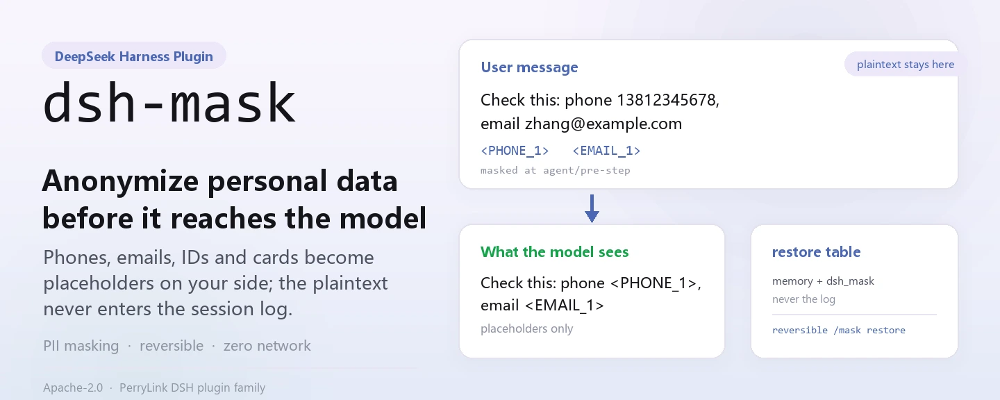
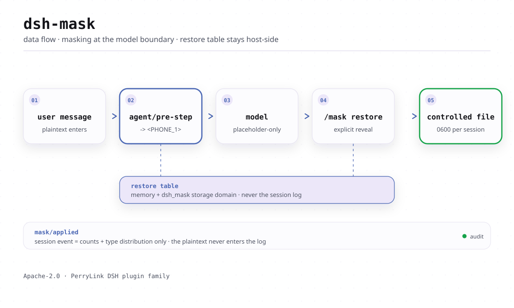
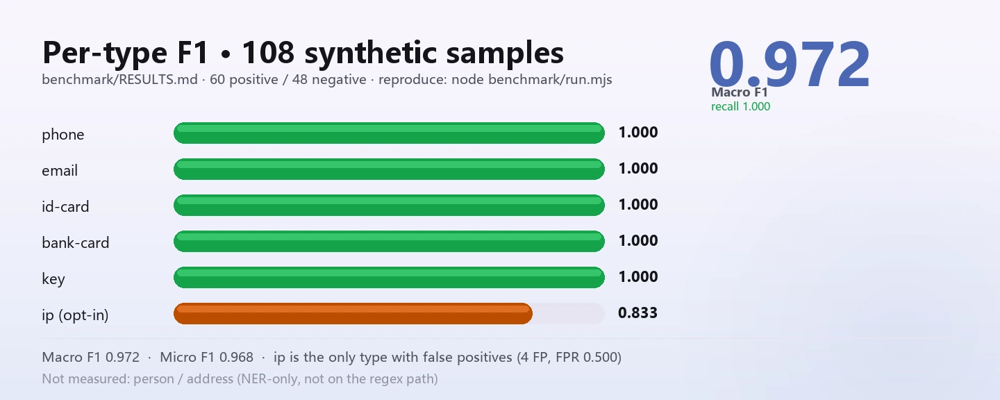

<div align="center">

<picture>
  <source media="(prefers-color-scheme: dark)" srcset="docs/assets/hero-en-dark-v3.webp">
  
</picture>

# dsh-mask

**Anonimiza los datos personales antes de que lleguen al modelo: el texto plano nunca entra en tu registro de sesión.**

Un middleware de enmascarado de PII puramente host-side para DeepSeek Harness: teléfonos, correos, documentos de identidad, tarjetas bancarias y claves se vuelven marcadores en el límite del modelo, y la tabla de restauración se queda en tu propia máquina.

[Instalar](#instalación-en-tres-pasos) · [Configuración](#configuración) · [FAQ](#faq) · [简体中文](README.md) · [English](README.en.md) · [Español](README.es.md) · [Português](README.pt.md) · [हिन्दी](README.hi.md)

[](LICENSE)
[](#compatibilidad)
[](https://www.npmjs.com/package/dsh-mask)
[](https://github.com/PerryLink/dsh-mask/actions/workflows/ci.yml)
[](#compatibilidad)

[](https://github.com/PerryLink/dsh-mask/stargazers)
[](https://www.npmjs.com/package/dsh-mask)
[](https://dshfind.com/plugins/PerryLink/dsh-mask?ref=badge)
[](https://securityscorecards.dev/viewer/?uri=github.com/PerryLink/dsh-mask)
[](https://dsh.market/)
[](https://gitee.com/perrylink/dsh-mask)

```sh
dsh plugin --profile <name> add dsh-mask
```

</div>

<sub>Plugin de la comunidad, no afiliado a DeepSeek. Repositorio canónico: <https://github.com/PerryLink/dsh-mask> (Gitee es un espejo).</sub>

## Qué es

Antes de que un mensaje llegue al modelo, `dsh-mask` reescribe los teléfonos, correos, documentos de identidad, tarjetas bancarias y claves que contiene en marcadores como `<PHONE_1>`: lo que el modelo ve y lo que el registro de sesión anota son solo marcadores. Los originales viven únicamente en la tabla de restauración host-side (memoria más el dominio de almacenamiento controlado `dsh_mask`), y una llamada explícita a `/mask restore` los devuelve como un archivo con permiso `0600` cuya ruta —nunca el texto plano— es lo que queda registrado. Regex puro, cero dependencias, sin peticiones de red.

<picture>
  <source media="(prefers-color-scheme: dark)" srcset="docs/assets/dsh-mask-flow-v3-dark.svg">
  
</picture>

## Instalación en tres pasos

1. **Instala** (elige un canal):

   ```sh
   # canal git (último main; equivalente a git+https://github.com/PerryLink/dsh-mask.git)
   dsh plugin --profile web add github:PerryLink/dsh-mask
   # canal npm (versiones publicadas)
   dsh plugin --profile web add dsh-mask
   # canal tarball: pnpm pack en este repo y luego
   dsh plugin --profile web add ./dsh-mask-<version>.tgz
   ```

   Sin paso de build: `index.mjs` y `lib/` son los artefactos enviados.

2. **Configuración mínima** (los valores por defecto ya funcionan; ajusta la lista de entidades si lo necesitas):

   ```yaml
   - insert:
       - id: mask
         name: dsh-mask
         config:
           entities: [phone, email, id-card, bank-card, key]
   ```

3. **Verifica que se monta**:

   ```sh
   dsh --profile web --dump-config | grep -A2 'id: mask'
   ```

   ```
   > /mask status
   > /mask restore <PHONE_1>
   mask: restored 1 placeholder(s): <PHONE_1>
     file: /tmp/dsh-mask-restore/restore-1f0c….txt  (mode 0600, one file per session)
   ```

**Desinstalar**: `dsh plugin --profile web remove dsh-mask` (o elimina la fila del patch del perfil).

> `dsh-mask` ya no incluye la pila de almacenamiento. Los perfiles que ya la componen (el perfil `web` lo hace, vía `@deepseek-ai/dsh-web-app`) proveen `storageDomain`, así que la persistencia funciona de serie. En un perfil básico sin almacenamiento el plugin se monta y enmascara igualmente, pero la tabla de restauración vive solo en memoria (se pierde al reiniciar): compón la pila de almacenamiento en tu patch de perfil, o pon `persistRestoreTable: false`.

<details>
<summary>Instalar desde el mercado de DSH Desktop</summary>

Todos los plugins de PerryLink pueden explorarse en el mercado integrado de DSH Desktop: **Market → Sources → add source → pegar** `https://perrylink-dsh-catalog.perrylink.workers.dev/catalog-source.json` **→ seleccionarlo**. La instalación sigue pasando por la verificación de identidad npm del mercado y tu confirmación.

</details>

## Capacidades clave

`dsh-mask` anonimiza datos personales **en el límite del modelo** —antes de que un mensaje llegue al modelo— y mantiene una tabla de restauración host-side para que los marcadores sean reversibles:

- **Enmascarado antes de la petición** — reescribe los mensajes de `agent/pre-step` para que teléfonos, correos, documentos, tarjetas y claves (activados por defecto) e IP (opt-in) se vuelvan marcadores como `<PHONE_1>`. El texto enmascarado es lo que se registra y se envía al modelo.
- **Tabla de restauración** — el mapa `marcador → original` vive solo en memoria y en un dominio de almacenamiento controlado (`dsh_mask`); el texto plano nunca entra en el registro de sesión.
- **Auditoría sin texto plano** — el evento de sesión `mask/applied` solo registra «N valores reemplazados + distribución por tipo», nunca el texto original ni el mapeo.
- **Comando `/mask`** — `status` (conteos + distribución), `on`/`off` (alternancia en tiempo de ejecución), `restore <text>` (desmapea marcadores y entrega el texto plano como archivo, nunca como texto registrable), `help`.
- **Herramienta `mask_test`** — prueba un fragmento con el detector y ve el resultado con marcadores; nunca revela los valores originales.

```text
mensaje de usuario ──agent/pre-step──▶ marcadores ──modelo──▶ marcadores ──restore──▶ archivo controlado
                                          ▲                                                 │
                                          └──── tabla de restauración (memoria + dsh_mask) ──┘
```

### Superficie de comandos y herramientas

| Superficie | Revela texto plano | Notas |
|---|---|---|
| Enmascarado `agent/pre-step` | nunca | Reescribe mensajes a marcadores antes de que se registren o se envíen al modelo |
| Enmascarado `tools/post-execute` | nunca | Reescribe bloques de texto de resultados de herramientas a marcadores antes de que se registren o se realimenten al modelo (scope: `tools`) |
| `/mask status` | nunca | Estado de activación, total reemplazado, distribución por tipo |
| `/mask on` / `/mask off` | nunca | Alternancia en tiempo de ejecución (vuelve a `config.enabled` al reiniciar) |
| `/mask restore <text>` | sí (explícito) | Desmapea marcadores a los valores guardados para esta sesión y los escribe en un archivo controlado (uno por sesión, modo `0600`); el texto del resultado y el registro de sesión solo llevan esa ruta y los nombres de los marcadores |
| `mask_test` | nunca | Enmascara un fragmento y reporta el resultado con marcadores + conteos |

### Ejemplos

Son los puntos de entrada reales del plugin; instala una vez y llama a uno.

**Ejemplo detallado** — comando `mask_test`, entrada:

```json
{"text":"电话 13812345678"}
```

Salida:

```text
mask_test: replaced 1 PII value(s) (PHONE=1)
masked:
电话 <PHONE_1>
```

*Observed from `plugins/dsh-mask/index.mjs:243-250; test/index.test.mjs:306-315`*

**Rama de fallo** — entrada:

```text
/mask restore <PHONE_1> with restoreDir=/tmp/dsh-mask-probe-not-a-dir (a regular file)
```

Salida:

```text
mask: restore failed: EEXIST: file already exists, mkdir '/tmp/dsh-mask-probe-not-a-dir'
```

*Observed from `plugins/dsh-mask/index.mjs:501-506; plugins/dsh-mask/lib/deliver.mjs:89-97; plugins/dsh-mask/test/index.test.mjs:278-290`*

**Ejemplos breves**: `mask_test` · `/mask restore <text>`

## Datos medidos

<picture>
  <source media="(prefers-color-scheme: dark)" srcset="docs/assets/dsh-mask-evidence-v3-en-dark.webp">
  
</picture>

El benchmark de P/R/F1 por tipo sobre 108 muestras sintéticas (60 positivas, 48 negativas) está publicado en [`benchmark/RESULTS.md`](benchmark/RESULTS.md); regenéralo con `node benchmark/run.mjs` (sin build, cero dependencias nuevas). El benchmark solo cubre la ruta regex: valida forma sin sumas de verificación, el regex de `ip` es permisivo con los rangos (de ahí sus falsos positivos) y `person`/`address` no se miden.

## Configuración

Todas las opciones son campos Schemastery `Config` (modificables desde cordis.yml). Una sobrescritura por id reemplaza la fila entera: repite cada clave que necesites. `cordis.patch.yml` documenta cada clave en línea.

Claves más usadas:

| Clave | Predeterminado | Significado |
|---|---|---|
| `enabled` | `true` | Interruptor maestro; `false` desregistra el listener, el comando `/mask` y la herramienta `mask_test` |
| `mode` | `regex` | Modo de detección; solo `regex` está implementado (`regex+ner` para nombre/dirección está reservado y falla en voz alta) |
| `entities` | `[phone, email, id-card, bank-card, key]` | Tipos de PII a enmascarar; `ip` también por regex (opt-in), `person`/`address` requieren NER |
| `scope` | `[messages]` | Superficie(s) de enmascarado; `messages` enmascara mensajes agent/pre-step, `tools` enmascara el texto de resultados de herramientas en tools/post-execute. Acepta una cadena o un array, p. ej. `[messages, tools]` |
| `persistRestoreTable` | `true` | Persiste la tabla de restauración en el dominio controlado `dsh_mask` (`false` = solo memoria) |
| `restoreDir` | `''` | Dónde entrega `/mask restore` el texto plano. Vacío = `os.tmpdir()/dsh-mask-restore`; un valor relativo se resuelve contra el cwd del proceso host. El directorio se crea `0700` y el archivo se escribe `0600`, uno por sesión |

<details>
<summary>Tabla de configuración completa (11 claves)</summary>

| Clave | Predeterminado | Significado |
|---|---|---|
| `enabled` | `true` | Interruptor maestro; `false` desregistra el listener, el comando `/mask` y la herramienta `mask_test` |
| `mode` | `regex` | Modo de detección; solo `regex` está implementado (`regex+ner` para nombre/dirección está reservado y falla en voz alta) |
| `entities` | `[phone, email, id-card, bank-card, key]` | Tipos de PII a enmascarar; `ip` también por regex (opt-in), `person`/`address` requieren NER |
| `scope` | `[messages]` | Superficie(s) de enmascarado; `messages` enmascara mensajes agent/pre-step, `tools` enmascara el texto de resultados de herramientas en tools/post-execute. Acepta una cadena o un array, p. ej. `[messages, tools]` |
| `registerCommand` | `true` | Registra el comando `/mask` |
| `registerTools` | `true` | Registra la herramienta `mask_test` cuando el servicio tools está presente |
| `persistRestoreTable` | `true` | Persiste la tabla de restauración en el dominio controlado `dsh_mask` (`false` = solo memoria) |
| `maxRestoreEntriesPerSession` | `500` | Tope de entradas de restauración por sesión (las más antiguas se expulsan primero) |
| `maxSessions` | `1000` | Tope de sesiones en memoria (expulsión LRU, el mapeo se recarga bajo demanda) |
| `maskClientEnabled` | `false` | Flag de función para la burbuja «revelar» de la mitad de navegador (defensivo; apagado por defecto hasta que el catálogo de slots en vivo verifique el slot objetivo). La clave está declarada y validada por el schema, pero ningún código en ejecución la lee todavía, así que no cambia nada hasta que llegue la mitad de navegador |
| `restoreDir` | `''` | Dónde entrega `/mask restore` el texto plano. Vacío = `os.tmpdir()/dsh-mask-restore`; un valor relativo se resuelve contra el cwd del proceso host. El directorio se crea `0700` y el archivo se escribe `0600`, uno por sesión |

</details>

Ejemplo de sobrescritura en tu patch de perfil:

```yaml
- insert:
    - id: mask
      name: dsh-mask
      config:
        entities: [phone, email, id-card, bank-card, key, ip]
        persistRestoreTable: false
        registerCommand: true
```

## FAQ

<details>
<summary>¿Dónde vive realmente el texto plano? ¿Puede filtrarse a los logs?</summary>

La tabla de restauración `marcador → original` vive en memoria y, con `persistRestoreTable: true`, en el dominio de almacenamiento controlado `dsh_mask`: **nunca se escribe en el registro de sesión**. La única otra copia en texto plano es el archivo de entrega que escribe un `/mask restore` explícito bajo `restoreDir` (modo `0600`, uno por sesión, sobrescrito por la siguiente restauración); nada escribe texto plano en disco de forma implícita.

</details>

<details>
<summary>¿Qué pasa en hosts sin almacenamiento o sin el tipo de evento? ¿Fallos silenciosos?</summary>

Nada es silencioso. En un perfil básico sin la pila de almacenamiento el plugin se monta y enmascara igualmente, con la tabla de restauración degradada a solo memoria más un aviso único. Cuando el host no registra el tipo de evento `mask/applied`, los appends de auditoría se omiten y la primera negativa de cada sesión deja un aviso visible. El `mode` no implementado (`regex+ner`), las entidades NER, los valores de `scope` desconocidos y los números fuera de rango fallan en voz alta al cargar.

</details>

<details>
<summary>¿Pelea con otros plugins por nombres de comando, eventos o slots?</summary>

No. Todas las herramientas llevan espacio de nombres, no provee ninguna clave de servicio, no registra slots de cliente ni prefijos `webServer`, y no muta globales; cada listener de eventos compartidos delega por `next()` y nunca cortocircuita la cadena. El argumento punto por punto está en «Interoperabilidad con otros plugins DSH».

</details>

<details>
<summary>¿Cuánto coste de rendimiento supone?</summary>

El detector es regex puro sin dependencias —sin peticiones de red, sin llamadas al modelo— y reescribe el texto de los mensajes de forma síncrona en `agent/pre-step`. Para la precisión medida, véase «Datos medidos» (108 muestras, Macro F1 0.972).

</details>

## Límites de seguridad

- **El texto plano nunca entra en el registro de sesión.** Lo registrado y enviado al modelo es la forma enmascarada (marcadores), así que el contenido visible para el modelo se reconstruye desde el log en forma de marcadores; los originales quedan en la tabla de restauración. La misma regla rige el revelado: el host registra el texto del resultado de un comando **literalmente** y renderiza desde ese mismo evento, así que `/mask restore` escribe el texto plano en un archivo controlado y solo devuelve la ruta.
- **Sanitizar antes de mostrar/registrar.** `lib/sanitize.mjs` redacta PII, secretos y credenciales de URL antes de que cualquier texto llegue al modelo o al log; `mask_test`, `/mask status` y todas las rutas de error de `/mask` nunca muestran originales.
- **Restauración controlada.** `/mask restore` es la única superficie de revelado explícita, y solo lee el mapeo de la sesión activa. El fallo es cerrado: si el archivo de entrega no puede escribirse, el comando reporta un error y nunca cae en mostrar el texto plano.
- **Fallo cerrado.** El `mode` no implementado (`regex+ner`), los valores de `scope` desconocidos, las entidades solo-NER y los números fuera de rango fallan en voz alta al cargar.
- **Registros como efectos.** El listener, el comando, la herramienta y el cierre del dominio de almacenamiento son efectos Cordis: parar o recargar en caliente los retira.

## Permisos y datos

- **Permisos**: `dsh-mask` no hace peticiones de red ni guarda credenciales; lee la sesión en el límite `agent/pre-step`, escribe en su propio dominio de almacenamiento `dsh_mask` y escribe el archivo de entrega de `/mask restore` (el manifest declara `filesystem:write` exactamente para eso). El manifest `dshWorkshop` también declara `network:none` y `credentials:none`.
- **Datos**: véase la primera entrada del FAQ para dónde viven la tabla de restauración y el archivo de entrega — la conclusión se mantiene: el texto plano nunca llega al registro de sesión.
- **Registro de sesión**: `mask/applied` se declara en `types.d.ts` y se añade solo cuando el host registra el tipo (véase Limitaciones conocidas). Su carga útil es solo conteos + distribución por tipo.

## Limitaciones conocidas

- **Solo regex.** El reconocimiento de nombres (`person`) y direcciones (`address`) necesita un reconocedor NER externo que la forma host-pura sin dependencias no incluye; `mode: regex+ner` y esas entidades fallan en voz alta al cargar. Los tipos cubiertos de serie son teléfono, correo, documento de identidad, tarjeta bancaria, clave e IP (opt-in).
- **Patrones específicos de región.** Los detectores `phone` e `id-card` solo reconocen formatos de China continental: `phone` es `1[3-9]` seguido de nueve dígitos, e `id-card` es un documento de residente chino de 18 caracteres (17 dígitos más un dígito o `X`). Los teléfonos y documentos de otros países no se detectan. `email`, `ip` y `key` no dependen de la región; `bank-card` acepta cualquier secuencia de 16-19 dígitos con menor confianza.
- **La restauración visual necesita una mitad de cliente.** Enmascarar es totalmente host-side, pero desenmascarar de forma transparente las burbujas del asistente en la UI del cliente es una función de la mitad de navegador que esta forma host-pura no incluye. El host conserva la tabla de restauración y el seam `RestoreStore` exportado (sus métodos piden un id de sesión), así que una futura mitad de cliente los consumiría mediante un remoto del host, no directamente; hoy la superficie de desenmascarado es el comando `/mask restore <text>`, que entrega el texto plano como archivo porque el resultado de un comando se registra literalmente (véase Límites de seguridad), y la clave `maskClientEnabled` se valida pero ningún código en ejecución la lee todavía.
- **No hay `/mask restore` sin argumentos.** Restaurar *todos* los marcadores del último mensaje del asistente no se ofrece, y el comando lo dice si se invoca sin texto. Dos hechos del host lo impiden: la tabla de restauración es un mapa plano `{marcador: original}` por sesión, **sin índice por mensaje**, así que ese mensaje hay que localizarlo en el registro de eventos de la sesión; y el host marcó `Session.snapshotEvents()` / `eventAt()` / `ownEvents()` como obsoletos con un «prohibido llamarlos desde código nuevo», dejando una proyección incremental como única vía sancionada —en la que el corredor de hosts declarado por este plugin (`>=0.1.2-rc.1`) no puede apoyarse. Los marcadores siguen restaurándose de uno en uno: `/mask restore <PHONE_1>`.
- **Eventos de sesión en `0.1.7-rc.2`.** El harness registra 59 tipos de evento de sesión y ninguno es `mask/*`; su `Session.append` tampoco puede estampar el sobre `ignorable`, así que los appends de auditoría del log de sesión se omiten (las sesiones siguen cargando). La puerta no es silenciosa: la primera negativa de cada sesión registra un aviso visible con el tipo omitido y esta limitación documentada. El plugin habilita el append automáticamente cuando un host registra el tipo o admite el sobre `ignorable`.

## Interoperabilidad con otros plugins DSH

Verificado contra **DSH `0.2.0-rc.2`** (el runtime para el que se publica este README) y el conjunto de plugins con más estrellas sondeado el 2026-10-05.

Este plugin **no interfiere** con otros plugins, incluidos los de más estrellas ampliamente instalados:

- **Sin colisión de nombres de herramienta.** Todas las herramientas llevan espacio de nombres; ninguna ocupa un nombre desnudo ya perteneciente a una herramienta incluida o a otro plugin.
- **Sin colisión de clave de servicio.** No provee ninguna clave de servicio, así que no puede colisionar en una.
- **Sin colisión de slot.** No registra ninguna clave de slot de cliente, así que no disputa un asiento `shadows-shipped-ui`.
- **Sin colisión de ruta HTTP.** No registra ningún prefijo `webServer`.
- **Sin colisión en la capa de patch.** El patch del bundle solo hace `insert` de su propia fila; nunca sobrescribe el `config` de una fila incluida.
- **Sin mutación global.** No parchea prototipos, ni reescribe `process.env`, ni reemplaza el dispatcher global de fetch.

**Los listeners de eventos compartidos no interfieren por construcción.** Observa los eventos sensibles al orden `agent/pre-step`, `tools/post-execute` con `ctx.on()` — el registro de difusión de Cordis, donde cada listener se ejecuta y ninguno puede dejar sin turno a otro. **Todos los listeners aquí delegan por `next()`**, así que la cadena nunca se cortocircuita, y la mutación se aplica sobre el valor que `next()` produjo en lugar de devolverse en su lugar:

- `agent/pre-step` — also used by `dsh-routing-suite` (7000★, 7 listeners), `modlens` (4122★), `dsh-purge` (3317★), `dsh-agent-teams` (1923★), `dsh-context` (1849★).
- `tools/post-execute` — also used by `cc-safety-net` (1576★).

Evidencia estática: `dsh-plugin-doctor` K10–K13 dan `pass` en todas las comprobaciones de este repositorio.

## Compatibilidad

| Superficie | Estado |
|---|---|
| Harness | DeepSeek Harness `dsh-v0.2.1-alpha.1` (adaptado el 2026-09-18): el sobre de sesión conserva su campo ignorable solo para compatibilidad de lectura de logs almacenados - Session.append aún no puede estamparlo, por lo que el comportamiento de la puerta no cambia. Verificado el 2026-09-18 contra el checkout master `dsh-v0.1.7-alpha.1` (cadena completa de puertas + smoke de instalación de perfil). |
| Node | `^22.19.0 \|\| >=24.0.0` |
| Plataformas | Donde corra DSH (host puro, regex sin dependencias; sin mitad de navegador) |
| Modelo | Modelos de texto totalmente soportados; no requiere capacidades extra del modelo |

## Ecosistema y calidad

- [Espejo de Gitee](https://gitee.com/perrylink/dsh-mask) (espejo sincronizado; GitHub es el canónico)
- [Página del plugin en dshfind](https://dshfind.com/plugins/PerryLink/dsh-mask) (instalaciones y ranking)
- [Informe de OpenSSF Scorecard](https://securityscorecards.dev/viewer/?uri=github.com/PerryLink/dsh-mask) (impulsado por [.github/workflows/scorecard.yml](.github/workflows/scorecard.yml))
- [Informe de verificación de dsh-plugin-doctor](https://github.com/PerryLink/dsh-plugin-doctor#verified-徽章) (K10–K13 todos `pass`)
- [DSH Market](https://dsh.market/) (listado)
- **Canal de la tienda 1024**: `npm i -g dsh1024` una vez y luego `dsh1024 plugin --profile web add dsh-mask` (cuenta para el ranking de instalaciones de [deepseek1024.com](https://deepseek1024.com))
- [Base de conocimiento del ecosistema](https://perrylink.github.io/dsh-plugin-guide/) — datos medidos, no marketing: guía de desarrollo de plugins · datos de selección · criterios de mantenimiento

## Desarrollo

```sh
pnpm install                                       # node ^22.19 || >=24
pnpm run typecheck && pnpm run typecheck:ci        # dos reglas: cara del checkout (con guarda; no verificable sin el checkout) + cara de la línea publicada
pnpm test                                          # node --test
pnpm run verify:self-contained                     # las specs de dependencias se resuelven desde el registry
pnpm run verify:artifacts                          # archivos enviados presentes + index.mjs importable
pnpm run check:readmes                             # consistencia de los README en cinco idiomas
pnpm pack                                          # el tarball publicado
```

Sin paso de build: ESM puro, `index.mjs` y `lib/` son los artefactos enviados. Benchmark: `node benchmark/run.mjs`, resultados en [`benchmark/RESULTS.md`](benchmark/RESULTS.md). Las imágenes del README se generan programáticamente con [`scripts/gen-readme-assets.py`](scripts/gen-readme-assets.py) (Python + Pillow) y se pueden reejecutar sin riesgo.

Topics: `dsh`, `dsh-plugin`, `deepseek-harness`, `deepseek`, `cordis`, `pii`, `mask`, `privacy`, `anonymization`, `security`

## Familia y agradecimientos

Este proyecto forma parte de la familia de plugins de DeepSeek Harness de [PerryLink](https://github.com/PerryLink) (todos Apache-2.0). Si te resulta útil, **una estrella ayuda a que la siguiente persona lo encuentre** — no hay nada bloqueado tras ella.

- [@PerryLink](https://github.com/PerryLink) — creador y mantenedor: el detector regex de PII portado desde Pii-Stripper-Middleware, el seam de enmascarado `agent/pre-step`, la tabla de restauración, el comando `/mask` y la herramienta `mask_test`, y la documentación en cinco idiomas.

<details>
<summary>Expandir todos los plugins</summary>

| Plugin | Estado |
|---|---|
| **[dsh-aqua-input-check](https://github.com/PerryLink/dsh-aqua-input-check)** |  |
| **[dsh-archive-check](https://github.com/PerryLink/dsh-archive-check)** |  |
| **[dsh-auto-review](https://github.com/PerryLink/dsh-auto-review)** |  |
| **[dsh-autotier](https://github.com/PerryLink/dsh-autotier)** | 🧊 CONGELADO — ver el README del repo |
| **[dsh-bid-ca-precheck](https://github.com/PerryLink/dsh-bid-ca-precheck)** |  |
| **[dsh-bid-qual-check](https://github.com/PerryLink/dsh-bid-qual-check)** |  |
| **[dsh-cert-mcp](https://github.com/PerryLink/dsh-cert-mcp)** | 🧊 CONGELADO — ver el README del repo |
| **[dsh-checkpoint-rewind](https://github.com/PerryLink/dsh-checkpoint-rewind)** |  |
| **[dsh-click](https://github.com/PerryLink/dsh-click)** |  |
| **[dsh-composer-history](https://github.com/PerryLink/dsh-composer-history)** |  |
| **[dsh-contract-stance](https://github.com/PerryLink/dsh-contract-stance)** |  |
| **[dsh-customs-doc-check](https://github.com/PerryLink/dsh-customs-doc-check)** |  |
| **[dsh-data-quality](https://github.com/PerryLink/dsh-data-quality)** |  |
| **[dsh-demurrage-ledger](https://github.com/PerryLink/dsh-demurrage-ledger)** |  |
| **[dsh-doublecheck](https://github.com/PerryLink/dsh-doublecheck)** |  |
| **[dsh-drill-script-check](https://github.com/PerryLink/dsh-drill-script-check)** |  |
| **[dsh-eia-guide-check](https://github.com/PerryLink/dsh-eia-guide-check)** |  |
| **[dsh-emergency-plan](https://github.com/PerryLink/dsh-emergency-plan)** |  |
| **[dsh-essay-rubric-check](https://github.com/PerryLink/dsh-essay-rubric-check)** |  |
| **[dsh-evidence-check](https://github.com/PerryLink/dsh-evidence-check)** |  |
| **[dsh-export-ctl-check](https://github.com/PerryLink/dsh-export-ctl-check)** |  |
| **[dsh-fast](https://github.com/PerryLink/dsh-fast)** |  |
| **[dsh-fmea-table-check](https://github.com/PerryLink/dsh-fmea-table-check)** |  |
| **[dsh-forecast-penalty](https://github.com/PerryLink/dsh-forecast-penalty)** |  |
| **[dsh-fund-research](https://github.com/PerryLink/dsh-fund-research)** |  |
| **[dsh-github](https://github.com/PerryLink/dsh-github)** |  |
| **[dsh-gongwen-flow-check](https://github.com/PerryLink/dsh-gongwen-flow-check)** |  |
| **[dsh-gongwen-word-check](https://github.com/PerryLink/dsh-gongwen-word-check)** |  |
| **[dsh-guard-plan-qc](https://github.com/PerryLink/dsh-guard-plan-qc)** |  |
| **[dsh-hazchem-check](https://github.com/PerryLink/dsh-hazchem-check)** |  |
| **[dsh-hazplan-check](https://github.com/PerryLink/dsh-hazplan-check)** |  |
| **[dsh-hidden-risk-map](https://github.com/PerryLink/dsh-hidden-risk-map)** |  |
| **[dsh-hs-classify](https://github.com/PerryLink/dsh-hs-classify)** |  |
| **[dsh-icd-rule-check](https://github.com/PerryLink/dsh-icd-rule-check)** |  |
| **[dsh-industry-research](https://github.com/PerryLink/dsh-industry-research)** |  |
| **[dsh-lawcite-adapter](https://github.com/PerryLink/dsh-lawcite-adapter)** |  |
| **[dsh-laya](https://github.com/PerryLink/dsh-laya)** |  |
| **[dsh-lc-doc-check](https://github.com/PerryLink/dsh-lc-doc-check)** |  |
| **[dsh-learning-gap-check](https://github.com/PerryLink/dsh-learning-gap-check)** |  |
| **[dsh-library](https://github.com/PerryLink/dsh-library)** |  |
| **[dsh-local-ai](https://github.com/PerryLink/dsh-local-ai)** |  |
| **[dsh-lsp-actions](https://github.com/PerryLink/dsh-lsp-actions)** |  |
| **[dsh-mask](https://github.com/PerryLink/dsh-mask)** |  |
| **[dsh-mcp-panel](https://github.com/PerryLink/dsh-mcp-panel)** |  |
| **[dsh-medrec-qc](https://github.com/PerryLink/dsh-medrec-qc)** |  |
| **[dsh-memento](https://github.com/PerryLink/dsh-memento)** |  |
| **[dsh-nsfc-form-check](https://github.com/PerryLink/dsh-nsfc-form-check)** |  |
| **[dsh-nurse-record-check](https://github.com/PerryLink/dsh-nurse-record-check)** |  |
| **[dsh-observe](https://github.com/PerryLink/dsh-observe)** |  |
| **[dsh-origin-rvc-check](https://github.com/PerryLink/dsh-origin-rvc-check)** |  |
| **[dsh-ota-review-check](https://github.com/PerryLink/dsh-ota-review-check)** |  |
| **[dsh-output-styles](https://github.com/PerryLink/dsh-output-styles)** |  |
| **[dsh-paper-doc-adapter](https://github.com/PerryLink/dsh-paper-doc-adapter)** |  |
| **[dsh-permission-rules](https://github.com/PerryLink/dsh-permission-rules)** |  |
| **[dsh-permit-report-check](https://github.com/PerryLink/dsh-permit-report-check)** |  |
| **[dsh-pipeline-check](https://github.com/PerryLink/dsh-pipeline-check)** |  |
| **[dsh-pleading-draft](https://github.com/PerryLink/dsh-pleading-draft)** |  |
| **[dsh-plugin-doctor](https://github.com/PerryLink/dsh-plugin-doctor)** | 🚫 RETIRADO (repo archivado) |
| **[dsh-plugin-guide](https://github.com/PerryLink/dsh-plugin-guide)** |  |
| **[dsh-plugin-kit](https://github.com/PerryLink/dsh-plugin-kit)** | 🚫 RETIRADO (repo archivado) |
| **[dsh-plugin-upgrade](https://github.com/PerryLink/dsh-plugin-upgrade)** | 🚫 RETIRADO (repo archivado) |
| **[dsh-policy-brief-draft](https://github.com/PerryLink/dsh-policy-brief-draft)** |  |
| **[dsh-power-loss-split](https://github.com/PerryLink/dsh-power-loss-split)** |  |
| **[dsh-power-ticket-check](https://github.com/PerryLink/dsh-power-ticket-check)** |  |
| **[dsh-ppap-check](https://github.com/PerryLink/dsh-ppap-check)** |  |
| **[dsh-protest-deadline](https://github.com/PerryLink/dsh-protest-deadline)** |  |
| **[dsh-railway-window](https://github.com/PerryLink/dsh-railway-window)** |  |
| **[dsh-repair-order-qc](https://github.com/PerryLink/dsh-repair-order-qc)** |  |
| **[dsh-research-report](https://github.com/PerryLink/dsh-research-report)** |  |
| **[dsh-review-reply-check](https://github.com/PerryLink/dsh-review-reply-check)** |  |
| **[dsh-rulefile-check](https://github.com/PerryLink/dsh-rulefile-check)** |  |
| **[dsh-safety-brief-check](https://github.com/PerryLink/dsh-safety-brief-check)** |  |
| **[dsh-score](https://github.com/PerryLink/dsh-score)** |  |
| **[dsh-session-sync](https://github.com/PerryLink/dsh-session-sync)** |  |
| **[dsh-site-log-check](https://github.com/PerryLink/dsh-site-log-check)** |  |
| **[dsh-skill-pack-security](https://github.com/PerryLink/dsh-skill-pack-security)** |  |
| **[dsh-soe-decision-check](https://github.com/PerryLink/dsh-soe-decision-check)** |  |
| **[dsh-soilwater-check](https://github.com/PerryLink/dsh-soilwater-check)** |  |
| **[dsh-sop-sync-check](https://github.com/PerryLink/dsh-sop-sync-check)** |  |
| **[dsh-spc-gbt-adapter](https://github.com/PerryLink/dsh-spc-gbt-adapter)** |  |
| **[dsh-talk](https://github.com/PerryLink/dsh-talk)** |  |
| **[dsh-tender-extract](https://github.com/PerryLink/dsh-tender-extract)** |  |
| **[dsh-tender-matrix](https://github.com/PerryLink/dsh-tender-matrix)** |  |
| **[dsh-test-drive](https://github.com/PerryLink/dsh-test-drive)** |  |
| **[dsh-ticktick](https://github.com/PerryLink/dsh-ticktick)** | 🚫 RETIRADO (repo archivado) |
| **[dsh-translate](https://github.com/PerryLink/dsh-translate)** |  |
| **[dsh-warranty-calc](https://github.com/PerryLink/dsh-warranty-calc)** |  |
| **[dsh-budget](https://github.com/PerryLink/dsh-budget)** | 🧊 CONGELADO — ver el README del repo |
| **[dsh-claude-move](https://github.com/PerryLink/dsh-claude-move)** | 🧊 CONGELADO — ver el README del repo |
| **[dsh-defend](https://github.com/PerryLink/dsh-defend)** | 🧊 CONGELADO — ver el README del repo |
| **[dsh-draw](https://github.com/PerryLink/dsh-draw)** | 🧊 CONGELADO — ver el README del repo |
| **[dsh-reach](https://github.com/PerryLink/dsh-reach)** | 🧊 CONGELADO — ver el README del repo |
| **[dsh-background-agents](https://github.com/PerryLink/dsh-background-agents)** | 🚫 RETIRADO (repo archivado) |
| **[dsh-session-pin](https://github.com/PerryLink/dsh-session-pin)** | 🚫 RETIRADO (repo archivado) |
| **[dsh-team-rooms](https://github.com/PerryLink/dsh-team-rooms)** | 🚫 RETIRADO (repo archivado) |

</details>

## Licencia

[LICENSE](LICENSE) (Apache License 2.0) © 2026 dsh-mask contributors

<p align="center"><sub>Apache-2.0 · Plugin de la comunidad, no afiliado a DeepSeek.</sub></p>
