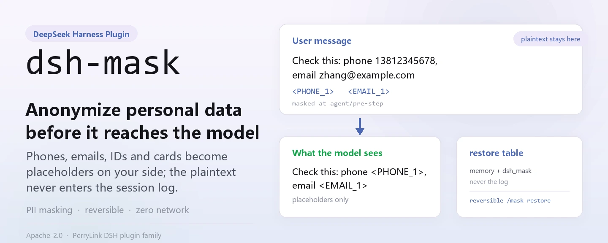
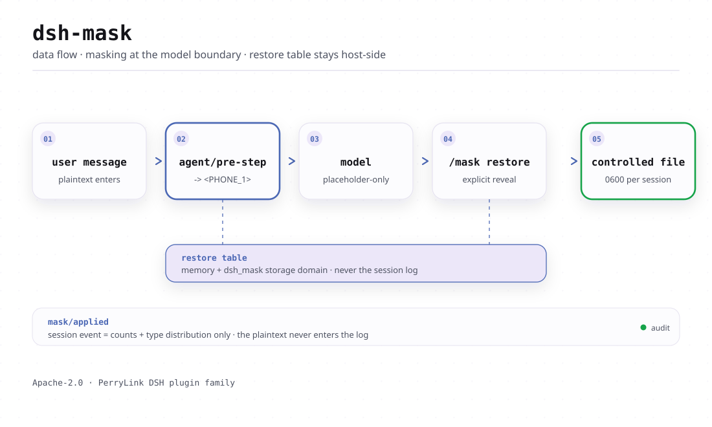
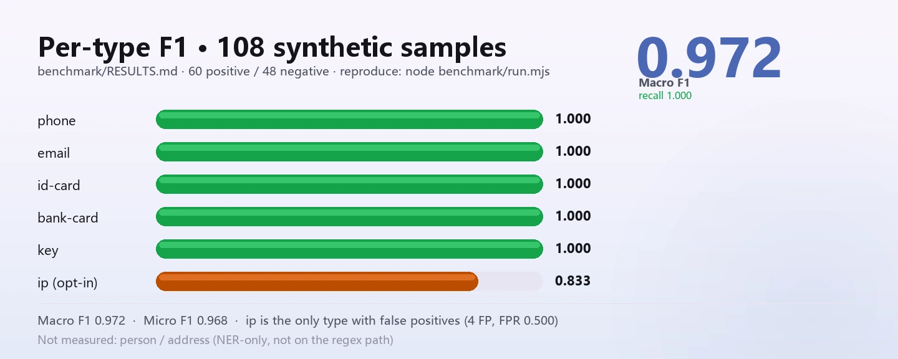

<div align="center">

<picture>
  <source media="(prefers-color-scheme: dark)" srcset="docs/assets/hero-en-dark-v3.webp">
  
</picture>

# dsh-mask

**व्यक्तिगत डेटा को मॉडल तक पहुँचने से पहले अनाम करें — मूल पाठ आपके सत्र लॉग में कभी नहीं जाता।**

DeepSeek Harness के लिए शुद्ध host-side PII मास्किंग मिडलवेयर: फ़ोन, ईमेल, आईडी कार्ड, बैंक कार्ड और कुंजियाँ मॉडल सीमा पर प्लेसहोल्डर बन जाते हैं, और पुनर्स्थापना तालिका आपकी अपनी मशीन पर रहती है।

[इंस्टॉल](#तीन-चरणों-में-शुरुआत) · [कॉन्फ़िगरेशन](#कॉन्फ़िगरेशन) · [FAQ](#faq) · [简体中文](README.md) · [English](README.en.md) · [Español](README.es.md) · [Português](README.pt.md) · [हिन्दी](README.hi.md)

[](LICENSE)
[](#संगतता)
[](https://www.npmjs.com/package/dsh-mask)
[](https://github.com/PerryLink/dsh-mask/actions/workflows/ci.yml)
[](#संगतता)

[](https://github.com/PerryLink/dsh-mask/stargazers)
[](https://www.npmjs.com/package/dsh-mask)
[](https://dshfind.com/plugins/PerryLink/dsh-mask?ref=badge)
[](https://securityscorecards.dev/viewer/?uri=github.com/PerryLink/dsh-mask)
[](https://dsh.market/)
[](https://gitee.com/perrylink/dsh-mask)

```sh
dsh plugin --profile <name> add dsh-mask
```

</div>

<sub>सामुदायिक प्लगइन, DeepSeek से असंबद्ध। कैनोनिकल रिपॉज़िटरी: <https://github.com/PerryLink/dsh-mask> (Gitee एक मिरर है)।</sub>

## यह क्या है

किसी संदेश के मॉडल तक पहुँचने से पहले, `dsh-mask` उसमें मौजूद फ़ोन, ईमेल, आईडी कार्ड, बैंक कार्ड और कुंजियों को `<PHONE_1>` जैसे प्लेसहोल्डर में बदल देता है — मॉडल जो देखता है और सत्र लॉग जो दर्ज करता है, वह केवल प्लेसहोल्डर होते हैं। मूल पाठ केवल host-side पुनर्स्थापना तालिका (मेमोरी और नियंत्रित `dsh_mask` स्टोरेज डोमेन) में रहता है, और स्पष्ट `/mask restore` कॉल उसे `0600` अनुमति वाली फ़ाइल के रूप में वापस सौंपता है जिसका पथ — मूल पाठ कभी नहीं — ही लॉग होता है। शुद्ध regex, शून्य निर्भरता, कोई नेटवर्क अनुरोध नहीं।

<picture>
  <source media="(prefers-color-scheme: dark)" srcset="docs/assets/dsh-mask-flow-v3-dark.svg">
  
</picture>

## तीन चरणों में शुरुआत

1. **इंस्टॉल करें** (एक चैनल चुनें):

   ```sh
   # git चैनल (नवीनतम main; git+https://github.com/PerryLink/dsh-mask.git के बराबर)
   dsh plugin --profile web add github:PerryLink/dsh-mask
   # npm चैनल (प्रकाशित रिलीज़)
   dsh plugin --profile web add dsh-mask
   # tarball चैनल: इस रेपो में pnpm pack करके
   dsh plugin --profile web add ./dsh-mask-<version>.tgz
   ```

   कोई build चरण नहीं: `index.mjs` और `lib/` ही भेजे गए आर्टिफ़ैक्ट हैं।

2. **न्यूनतम कॉन्फ़िग** (डिफ़ॉल्ट से ही चलता है; आवश्यकतानुसार इकाई सूची बदलें):

   ```yaml
   - insert:
       - id: mask
         name: dsh-mask
         config:
           entities: [phone, email, id-card, bank-card, key]
   ```

3. **माउंट सत्यापित करें**:

   ```sh
   dsh --profile web --dump-config | grep -A2 'id: mask'
   ```

   ```
   > /mask status
   > /mask restore <PHONE_1>
   mask: restored 1 placeholder(s): <PHONE_1>
     file: /tmp/dsh-mask-restore/restore-1f0c….txt  (mode 0600, one file per session)
   ```

**अनइंस्टॉल**: `dsh plugin --profile web remove dsh-mask` (या प्रोफ़ाइल पैच से वह पंक्ति हटाएँ)।

> `dsh-mask` अब storage स्टैक बंडल नहीं करता। जो प्रोफ़ाइल इसे पहले से रचती हैं (`web` प्रोफ़ाइल `@deepseek-ai/dsh-web-app` के ज़रिए करती है) वे `storageDomain` देती हैं, इसलिए persistence तुरंत काम करता है। बिना storage वाले bare प्रोफ़ाइल में प्लगइन फिर भी माउंट होता है और मास्क करता है, पर पुनर्स्थापना तालिका केवल मेमोरी में रहती है (रीस्टार्ट पर खो जाती है): अपने प्रोफ़ाइल पैच में storage स्टैक रचें, या `persistRestoreTable: false` करें।

<details>
<summary>DSH Desktop मार्केट से इंस्टॉल करें</summary>

सभी PerryLink प्लगइन DSH Desktop के अंतर्निहित मार्केट में ब्राउज़ किए जा सकते हैं: **Market → Sources → Add source → पेस्ट करें** `https://perrylink-dsh-catalog.perrylink.workers.dev/catalog-source.json` **→ चुनें**। इंस्टॉलेशन के लिए मार्केट की npm पहचान जाँच और आपकी पुष्टि आवश्यक रहती है।

</details>

## मुख्य क्षमताएँ

`dsh-mask` व्यक्तिगत डेटा को **मॉडल सीमा पर** अनाम करता है — संदेश के मॉडल तक पहुँचने से पहले — और पुनर्स्थापना तालिका host-side रखता है ताकि प्लेसहोल्डर उलटने योग्य रहें:

- **अनुरोध से पहले मास्किंग** — `agent/pre-step` संदेशों को फिर से लिखता है ताकि फ़ोन, ईमेल, आईडी कार्ड, बैंक कार्ड और कुंजियाँ (डिफ़ॉल्ट रूप से चालू) और IP (opt-in) `<PHONE_1>` जैसे प्लेसहोल्डर बन जाएँ। मास्क किया हुआ पाठ ही लॉग होता है और मॉडल को जाता है।
- **पुनर्स्थापना तालिका** — `प्लेसहोल्डर → मूल` नक्शा केवल मेमोरी और नियंत्रित स्टोरेज डोमेन (`dsh_mask`) में रहता है; मूल पाठ सत्र लॉग में कभी नहीं जाता।
- **बिना मूल पाठ की ऑडिट** — `mask/applied` सत्र इवेंट केवल «N मान बदले + प्रकार-वितरण» दर्ज करता है, मूल पाठ या नक्शा कभी नहीं।
- **`/mask` कमांड** — `status` (गिनती + वितरण), `on`/`off` (रनटाइम टॉगल), `restore <text>` (प्लेसहोल्डर वापस मूल में बदलकर मूल पाठ को फ़ाइल के रूप में सौंपता है, लॉग होने योग्य पाठ के रूप में कभी नहीं), `help`।
- **`mask_test` टूल** — एक अंश डिटेक्टर से चलाकर प्लेसहोल्डर परिणाम देखें; मूल मान कभी नहीं दिखाता।

```text
उपयोगकर्ता संदेश ──agent/pre-step──▶ प्लेसहोल्डर ──मॉडल──▶ प्लेसहोल्डर ──restore──▶ नियंत्रित फ़ाइल
                                        ▲                                                    │
                                        └──── पुनर्स्थापना तालिका (मेमोरी + dsh_mask) ────────┘
```

### कमांड और टूल सतह

| सतह | मूल पाठ दिखाता है | नोट्स |
|---|---|---|
| `agent/pre-step` मास्किंग | कभी नहीं | संदेशों को लॉग होने या मॉडल को जाने से पहले प्लेसहोल्डर में बदलता है |
| `tools/post-execute` मास्किंग | कभी नहीं | टूल परिणाम के टेक्स्ट ब्लॉक को लॉग होने या मॉडल को वापस जाने से पहले प्लेसहोल्डर में बदलता है (scope: `tools`) |
| `/mask status` | कभी नहीं | सक्षम स्थिति, कुल बदले गए, प्रकार-वितरण |
| `/mask on` / `/mask off` | कभी नहीं | रनटाइम टॉगल (रीस्टार्ट पर `config.enabled` पर लौटता है) |
| `/mask restore <text>` | हाँ (स्पष्ट) | प्लेसहोल्डर को इस सत्र के संग्रहीत मानों में बदलकर नियंत्रित फ़ाइल में लिखता है (प्रति सत्र एक, mode `0600`); परिणाम पाठ और सत्र लॉग में केवल वह पथ और प्लेसहोल्डर नाम जाते हैं |
| `mask_test` | कभी नहीं | अंश को मास्क करके प्लेसहोल्डर परिणाम + गिनती देता है |

### उदाहरण

ये प्लगइन के वास्तविक प्रवेश बिंदु हैं; एक बार इंस्टॉल करके एक चलाएँ।

**विस्तृत उदाहरण** — कमांड `mask_test`, इनपुट:

```json
{"text":"电话 13812345678"}
```

आउटपुट:

```text
mask_test: replaced 1 PII value(s) (PHONE=1)
masked:
电话 <PHONE_1>
```

*Observed from `plugins/dsh-mask/index.mjs:243-250; test/index.test.mjs:306-315`*

**विफलता शाखा** — इनपुट:

```text
/mask restore <PHONE_1> with restoreDir=/tmp/dsh-mask-probe-not-a-dir (a regular file)
```

आउटपुट:

```text
mask: restore failed: EEXIST: file already exists, mkdir '/tmp/dsh-mask-probe-not-a-dir'
```

*Observed from `plugins/dsh-mask/index.mjs:501-506; plugins/dsh-mask/lib/deliver.mjs:89-97; plugins/dsh-mask/test/index.test.mjs:278-290`*

**संक्षिप्त उदाहरण**: `mask_test` · `/mask restore <text>`

## मापे गए आँकड़े

<picture>
  <source media="(prefers-color-scheme: dark)" srcset="docs/assets/dsh-mask-evidence-v3-en-dark.webp">
  
</picture>

108 सिंथेटिक नमूनों (60 धनात्मक, 48 ऋणात्मक) पर प्रति-प्रकार P/R/F1 बेंचमार्क [`benchmark/RESULTS.md`](benchmark/RESULTS.md) में प्रकाशित है; `node benchmark/run.mjs` से दोबारा बनाएँ (कोई build नहीं, कोई नई निर्भरता नहीं)। बेंचमार्क केवल regex पथ को मापता है: बिना चेकसम के आकार जाँच, `ip` regex रेंज के प्रति ढीला है (इसीलिए उसके false positive), और `person`/`address` नहीं मापे गए।

## कॉन्फ़िगरेशन

सभी विकल्प Schemastery `Config` फ़ील्ड हैं (cordis.yml से बदले जा सकते हैं)। id-लक्षित ओवरराइड पूरी पंक्ति बदल देता है — जो कुंजियाँ चाहिए वे सब दोबारा लिखें। `cordis.patch.yml` हर कुंजी का इनलाइन दस्तावेज़ देता है।

सबसे अधिक उपयोग होने वाली कुंजियाँ:

| कुंजी | डिफ़ॉल्ट | अर्थ |
|---|---|---|
| `enabled` | `true` | मुख्य स्विच; `false` listener, `/mask` कमांड और `mask_test` टूल हटा देता है |
| `mode` | `regex` | डिटेक्शन मोड; केवल `regex` लागू (नाम/पता पहचान के लिए `regex+ner` आरक्षित और लोड पर विफल) |
| `entities` | `[phone, email, id-card, bank-card, key]` | कौन से PII प्रकार मास्क करने हैं; `ip` भी regex-सक्षम (opt-in), `person`/`address` को NER चाहिए |
| `scope` | `[messages]` | मास्किंग सतह; `messages` agent/pre-step संदेश मास्क करता है, `tools` tools/post-execute पर टूल परिणाम पाठ मास्क करता है। स्ट्रिंग या array स्वीकार करता है, जैसे `[messages, tools]` |
| `persistRestoreTable` | `true` | पुनर्स्थापना तालिका को नियंत्रित `dsh_mask` डोमेन में सहेजें (`false` = केवल मेमोरी) |
| `restoreDir` | `''` | `/mask restore` मूल पाठ कहाँ सौंपता है। खाली = `os.tmpdir()/dsh-mask-restore`; सापेक्ष मान host प्रक्रिया के cwd के सापेक्ष हल होता है। डायरेक्टरी `0700` पर बनती है और फ़ाइल `0600` पर लिखी जाती है, प्रति सत्र एक |

<details>
<summary>पूर्ण कॉन्फ़िगरेशन तालिका (11 कुंजियाँ)</summary>

| कुंजी | डिफ़ॉल्ट | अर्थ |
|---|---|---|
| `enabled` | `true` | मुख्य स्विच; `false` listener, `/mask` कमांड और `mask_test` टूल हटा देता है |
| `mode` | `regex` | डिटेक्शन मोड; केवल `regex` लागू (नाम/पता पहचान के लिए `regex+ner` आरक्षित और लोड पर विफल) |
| `entities` | `[phone, email, id-card, bank-card, key]` | कौन से PII प्रकार मास्क करने हैं; `ip` भी regex-सक्षम (opt-in), `person`/`address` को NER चाहिए |
| `scope` | `[messages]` | मास्किंग सतह; `messages` agent/pre-step संदेश मास्क करता है, `tools` tools/post-execute पर टूल परिणाम पाठ मास्क करता है। स्ट्रिंग या array स्वीकार करता है, जैसे `[messages, tools]` |
| `registerCommand` | `true` | `/mask` कमांड पंजीकृत करें |
| `registerTools` | `true` | tools सेवा मौजूद होने पर `mask_test` टूल पंजीकृत करें |
| `persistRestoreTable` | `true` | पुनर्स्थापना तालिका को नियंत्रित `dsh_mask` डोमेन में सहेजें (`false` = केवल मेमोरी) |
| `maxRestoreEntriesPerSession` | `500` | प्रति सत्र पुनर्स्थापना प्रविष्टि सीमा (सबसे पुरानी पहले हटती है) |
| `maxSessions` | `1000` | मेमोरी में सत्र सीमा (LRU हटाव, नक्शा माँग पर पुनः लोड) |
| `maskClientEnabled` | `false` | ब्राउज़र आधे के «reveal» बबल के लिए फ़ीचर फ़्लैग (रक्षात्मक; लाइव स्लॉट कैटलॉग लक्ष्य स्लॉट सत्यापित करने तक डिफ़ॉल्ट रूप से बंद)। कुंजी schema में घोषित व मान्य है, पर अभी कोई रनटाइम कोड उसे नहीं पढ़ता, इसलिए ब्राउज़र आधा आने तक यह कुछ नहीं बदलती |
| `restoreDir` | `''` | `/mask restore` मूल पाठ कहाँ सौंपता है। खाली = `os.tmpdir()/dsh-mask-restore`; सापेक्ष मान host प्रक्रिया के cwd के सापेक्ष हल होता है। डायरेक्टरी `0700` पर बनती है और फ़ाइल `0600` पर लिखी जाती है, प्रति सत्र एक |

</details>

आपके प्रोफ़ाइल पैच में ओवरराइड उदाहरण:

```yaml
- insert:
    - id: mask
      name: dsh-mask
      config:
        entities: [phone, email, id-card, bank-card, key, ip]
        persistRestoreTable: false
        registerCommand: true
```

## FAQ

<details>
<summary>मूल पाठ असल में कहाँ रहता है? क्या वह लॉग में जा सकता है?</summary>

`प्लेसहोल्डर → मूल` पुनर्स्थापना तालिका मेमोरी में और, `persistRestoreTable: true` होने पर, नियंत्रित `dsh_mask` स्टोरेज डोमेन में रहती है — **सत्र लॉग में कभी नहीं लिखी जाती**। मूल पाठ की एकमात्र अन्य प्रति वह डिलीवरी फ़ाइल है जो स्पष्ट `/mask restore` `restoreDir` के नीचे लिखता है (mode `0600`, प्रति सत्र एक, अगली पुनर्स्थापना उसे ओवरराइट करती है); कोई भी पथ चुपचाप मूल पाठ डिस्क पर नहीं लिखता।

</details>

<details>
<summary>स्टोरेज या इवेंट प्रकार के बिना host पर क्या होता है? चुपचाप टूटता है?</summary>

कुछ भी मौन नहीं है। बिना storage स्टैक वाले bare प्रोफ़ाइल में प्लगइन फिर भी माउंट होता है और मास्क करता है, पुनर्स्थापना तालिका केवल-मेमोरी में उतर जाती है और एक बार चेतावनी मिलती है। जब host `mask/applied` इवेंट प्रकार दर्ज नहीं करता, ऑडिट appends छोड़े जाते हैं और प्रत्येक सत्र की पहली अस्वीकृति पर एक दृश्य चेतावनी लॉग होती है। अलागू `mode` (`regex+ner`), NER इकाइयाँ, अज्ञात `scope` मान और सीमा से बाहर संख्याएँ सभी लोड पर ज़ोर से विफल होती हैं।

</details>

<details>
<summary>क्या यह अन्य प्लगइनों से कमांड नाम, ईवेंट या स्लॉट के लिए टकराता है?</summary>

नहीं। सभी टूल नेमस्पेस युक्त हैं, यह कोई सर्विस key प्रदान नहीं करता, कोई क्लाइंट स्लॉट या `webServer` प्रीफ़िक्स पंजीकृत नहीं करता, और ग्लोबल में बदलाव नहीं करता; साझा-ईवेंट का प्रत्येक लिसनर `next()` से डेलिगेट करता है और श्रृंखला को कभी शॉर्ट-सर्किट नहीं करता। बिंदु-दर-बिंदु तर्क «अन्य DSH प्लगइनों के साथ इंटरऑपरेबिलिटी» में है।

</details>

<details>
<summary>प्रदर्शन लागत कितनी है?</summary>

डिटेक्टर शून्य-निर्भरता शुद्ध regex है — कोई नेटवर्क अनुरोध नहीं, कोई मॉडल कॉल नहीं — और `agent/pre-step` पर संदेश पाठ को समकालिक रूप से फिर से लिखता है। मापी गई सटीकता के लिए «मापे गए आँकड़े» देखें (108 नमूने, Macro F1 0.972)।

</details>

## सुरक्षा सीमाएँ

- **मूल पाठ सत्र लॉग में कभी नहीं जाता।** लॉग होने और मॉडल को जाने वाला रूप मास्क (प्लेसहोल्डर) ही है, इसलिए मॉडल-दृश्य सामग्री लॉग से प्लेसहोल्डर रूप में पुनर्निर्मित की जा सकती है; मूल पुनर्स्थापना तालिका में रहते हैं। यही नियम प्रकटीकरण की दिशा पर भी लागू है: host कमांड के परिणाम पाठ को **शब्दशः** लॉग करता है और उसी इवेंट से दृश्य आउटपुट बनाता है, इसलिए `/mask restore` मूल पाठ को नियंत्रित फ़ाइल में लिखता है और केवल पथ लौटाता है।
- **दिखाने/लॉग से पहले सैनिटाइज़।** `lib/sanitize.mjs` किसी भी पाठ के मॉडल या लॉग तक पहुँचने से पहले PII, रहस्य और URL क्रेडेंशियल हटाता है; `mask_test`, `/mask status` और `/mask` के सभी त्रुटि पथ मूल कभी नहीं दिखाते।
- **नियंत्रित पुनर्स्थापना।** `/mask restore` एकमात्र स्पष्ट प्रकटीकरण सतह है, और केवल सक्रिय सत्र का नक्शा पढ़ता है। विफलता फेल-क्लोज़्ड है: डिलीवरी फ़ाइल न लिखी जा सके तो कमांड त्रुटि बताता है और मूल पाठ दिखाने वाले fallback पर कभी नहीं उतरता।
- **फेल क्लोज़्ड।** अलागू `mode` (`regex+ner`), अज्ञात `scope` मान, केवल-NER इकाइयाँ और सीमा से बाहर संख्याएँ सभी लोड पर ज़ोर से विफल होती हैं।
- **पंजीकरण प्रभाव हैं।** listener, कमांड, टूल और स्टोरेज-डोमेन बंद सभी Cordis effects हैं — रोकने/हॉट-रिलोड पर हट जाते हैं।

## अनुमतियाँ और डेटा

- **अनुमतियाँ**: `dsh-mask` कोई नेटवर्क अनुरोध नहीं करता और कोई क्रेडेंशियल नहीं रखता; यह `agent/pre-step` सीमा पर सत्र पढ़ता है, अपना `dsh_mask` स्टोरेज डोमेन लिखता है, और `/mask restore` की डिलीवरी फ़ाइल लिखता है (manifest ठीक इसी के लिए `filesystem:write` घोषित करता है)। `dshWorkshop` manifest `network:none` और `credentials:none` भी घोषित करता है।
- **डेटा**: पुनर्स्थापना तालिका और डिलीवरी फ़ाइल कहाँ रहती हैं, यह FAQ की पहली प्रविष्टि देखें — निष्कर्ष वही है: मूल पाठ सत्र लॉग तक कभी नहीं पहुँचता।
- **सत्र लॉग**: `mask/applied` `types.d.ts` में घोषित है और केवल तब जोड़ा जाता है जब host प्रकार दर्ज करे (ज्ञात सीमाएँ देखें)। इसका पेलोड केवल गिनती + प्रकार-वितरण है।

## ज्ञात सीमाएँ

- **केवल regex।** नाम (`person`) और पता (`address`) पहचान को बाहरी NER पहचानकर्ता चाहिए, जिसे शुद्ध-host शून्य-निर्भरता रूप बंडल नहीं करता; `mode: regex+ner` और वे इकाइयाँ लोड पर ज़ोर से विफल होती हैं। बॉक्स से मिलने वाले PII प्रकार: फ़ोन, ईमेल, आईडी कार्ड, बैंक कार्ड, कुंजी और IP (opt-in)।
- **क्षेत्र-विशिष्ट पैटर्न।** `phone` और `id-card` डिटेक्टर केवल मुख्य भूमि चीन के प्रारूप पहचानते हैं: `phone` = `1[3-9]` के बाद नौ अंक, और `id-card` = 18 वर्णों वाला चीनी निवासी आईडी (17 अंक और एक अंक या `X`)। अन्य देशों के फ़ोन नंबर और राष्ट्रीय पहचान पत्र नहीं पकड़े जाते। `email`, `ip` और `key` क्षेत्र-निरपेक्ष हैं; `bank-card` किसी भी 16-19 अंकों की श्रृंखला को कम विश्वास के साथ स्वीकार करता है।
- **डिस्प्ले-लेयर पुनर्स्थापना को क्लाइंट आधा चाहिए।** मास्किंग पूरी तरह host-side है, पर क्लाइंट UI में assistant बबल को पारदर्शी रूप से खोलना एक ब्राउज़र-आधा सुविधा है जो यह शुद्ध-host रूप नहीं देता। host पुनर्स्थापना तालिका और निर्यातित `RestoreStore` seam रखता है (उसके मेथड को session id चाहिए), इसलिए भविष्य का क्लाइंट आधा उन्हें host remote से लेगा, सीधे नहीं; आज अनमास्किंग सतह `/mask restore <text>` कमांड है, जो मूल पाठ फ़ाइल के रूप में सौंपता है क्योंकि कमांड परिणाम शब्दशः लॉग होता है (सुरक्षा सीमाएँ देखें), और `maskClientEnabled` कुंजी मान्य होती है पर अभी कोई रनटाइम कोड उसे नहीं पढ़ता।
- **बिना आर्ग्युमेंट `/mask restore` नहीं है।** अंतिम assistant संदेश के *सभी* प्लेसहोल्डर वापस लाना उपलब्ध नहीं है, और बिना पाठ के चलाने पर कमांड यह बता देता है। दो host तथ्य इसे रोकते हैं: पुनर्स्थापना तालिका प्रति सत्र सपाट `{प्लेसहोल्डर: मूल}` नक्शा है, जिसमें **संदेश-वार सूचकांक नहीं** है, इसलिए वह संदेश सत्र इवेंट लॉग में खोजना पड़ता है; और host ने `Session.snapshotEvents()` / `eventAt()` / `ownEvents()` को deprecated करके «नए कॉलर निषिद्ध» घोषित किया है, जिससे इंक्रीमेंटल प्रोजेक्शन एकमात्र स्वीकृत मार्ग रह गया — जिस पर इस प्लगइन का घोषित host corridor (`>=0.1.2-rc.1`) भरोसा नहीं कर सकता। प्लेसहोल्डर एक-एक करके वापस लाए जा सकते हैं: `/mask restore <PHONE_1>`।
- **`0.1.7-rc.2` पर सत्र इवेंट।** harness 59 सत्र-इवेंट प्रकार दर्ज करता है और उनमें `mask/*` नहीं है; उसका `Session.append` `ignorable` लिफ़ाफ़ा भी नहीं लगा सकता, इसलिए सत्र-लॉग ऑडिट appends छोड़े जाते हैं (सत्र लोड होते रहते हैं)। गेट मौन नहीं है: प्रत्येक सत्र की पहली अस्वीकृति पर छोड़े गए प्रकार और इस प्रलेखित सीमा के साथ एक दृश्य चेतावनी दर्ज होती है। जब host प्रकार दर्ज करे या `ignorable` लिफ़ाफ़ा स्वीकार करे, प्लगइन append स्वतः सक्षम कर देता है।

## अन्य DSH प्लगइनों के साथ इंटरऑपरेबिलिटी

**DSH `0.2.0-rc.2`** (वह रनटाइम जिसके लिए यह README प्रकाशित है) और 2026-10-05 को सर्वे किए गए उच्च-स्टार प्लगइन सेट के विरुद्ध सत्यापित।

यह प्लगइन अन्य प्लगइनों में **हस्तक्षेप नहीं करता**, उन व्यापक रूप से इंस्टॉल उच्च-स्टार प्लगइनों सहित:

- **कोई टूल-नाम टकराव नहीं।** सभी टूल नेमस्पेस युक्त हैं; कोई भी ऐसा नंगा नाम नहीं लेता जो पहले से किसी अंतर्निहित टूल या अन्य प्लगइन का हो।
- **कोई सर्विस-की टकराव नहीं।** यह कोई सर्विस key प्रदान नहीं करता, इसलिए टकराव संभव नहीं।
- **कोई स्लॉट टकराव नहीं।** यह कोई क्लाइंट slot key पंजीकृत नहीं करता, इसलिए `shadows-shipped-ui` सीट के लिए प्रतिस्पर्धा नहीं करता।
- **कोई HTTP रूट टकराव नहीं।** यह कोई `webServer` प्रीफ़िक्स पंजीकृत नहीं करता।
- **कोई patch-लेयर टकराव नहीं।** बंडल patch केवल अपनी पंक्ति `insert` करता है; कभी किसी अंतर्निहित पंक्ति का `config` ओवरराइड नहीं करता।
- **कोई वैश्विक परिवर्तन नहीं।** यह प्रोटोटाइप नहीं बदलता, `process.env` नहीं लिखता, और वैश्विक fetch dispatcher प्रतिस्थापित नहीं करता।

**साझा ईवेंट लिसनर रचना से ही अहस्तक्षेपी हैं।** यह क्रम-संवेदनशील ईवेंट `agent/pre-step`, `tools/post-execute` को `ctx.on()` से देखता है — Cordis का **ब्रॉडकास्ट** पंजीकरण, जहाँ हर लिसनर चलता है और कोई किसी दूसरे को वंचित नहीं कर सकता। **यहाँ प्रत्येक लिसनर `next()` से डेलिगेट करता है**, इसलिए श्रृंखला कभी शॉर्ट-सर्किट नहीं होती, और बदलाव `next()` के दिए मान पर लागू होता है, उसकी जगह लौटाया नहीं जाता:

- `agent/pre-step` — also used by `dsh-routing-suite` (7000★, 7 listeners), `modlens` (4122★), `dsh-purge` (3317★), `dsh-agent-teams` (1923★), `dsh-context` (1849★).
- `tools/post-execute` — also used by `cc-safety-net` (1576★).

स्थैतिक प्रमाण: इस रिपॉज़िटरी पर `dsh-plugin-doctor` के K10–K13 सभी `pass` हैं।

## संगतता

| सतह | स्थिति |
|---|---|
| Harness | DeepSeek Harness `dsh-v0.2.1-alpha.1` (2026-09-18 को अनुकूलित): सत्र लिफ़ाफ़ा अपना ignorable फ़ील्ड केवल संग्रहीत-लॉग पठन संगतता के लिए रखता है - Session.append अभी भी इसे स्टैम्प नहीं कर सकता, इसलिए गेट व्यवहार अपरिवर्तित है। 2026-09-18 को `dsh-v0.1.7-alpha.1` master checkout के विरुद्ध सत्यापित (पूर्ण गेट शृंखला + profile इंस्टॉल स्मोक)। |
| Node | `^22.19.0 \|\| >=24.0.0` |
| प्लेटफ़ॉर्म | जहाँ DSH चले (शुद्ध host, शून्य-निर्भरता regex; कोई ब्राउज़र आधा नहीं) |
| मॉडल | टेक्स्ट मॉडल पूर्ण रूप से समर्थित; कोई अतिरिक्त मॉडल क्षमता आवश्यक नहीं |

## इकोसिस्टम और गुणवत्ता

- [Gitee मिरर](https://gitee.com/perrylink/dsh-mask) (सिंक मिरर; GitHub कैनोनिकल है)
- [dshfind प्लगइन पेज](https://dshfind.com/plugins/PerryLink/dsh-mask) (इंस्टॉल और रैंकिंग)
- [OpenSSF Scorecard रिपोर्ट](https://securityscorecards.dev/viewer/?uri=github.com/PerryLink/dsh-mask) ([.github/workflows/scorecard.yml](.github/workflows/scorecard.yml) द्वारा संचालित)
- [dsh-plugin-doctor सत्यापन रिपोर्ट](https://github.com/PerryLink/dsh-plugin-doctor#verified-徽章) (K10–K13 सभी `pass`)
- [DSH Market](https://dsh.market/) (सूचीबद्ध)
- **1024 स्टोर चैनल**: एक बार `npm i -g dsh1024`, फिर `dsh1024 plugin --profile web add dsh-mask` ([deepseek1024.com](https://deepseek1024.com) इंस्टॉल रैंकिंग में गिना जाता है)
- [इकोसिस्टम नॉलेज बेस](https://perrylink.github.io/dsh-plugin-guide/) — मापे गए आँकड़े, मार्केटिंग नहीं: डेवलपमेंट गाइड · चयन डेटा · रखरखाव मानदंड

## डेवलपमेंट

```sh
pnpm install                                       # node ^22.19 || >=24
pnpm run typecheck && pnpm run typecheck:ci        # दो मापदंड: checkout फ़ेस (गार्डेड; checkout बिना सत्यापनयोग्य नहीं) + प्रकाशित-लाइन फ़ेस
pnpm test                                          # node --test
pnpm run verify:self-contained                     # निर्भरता स्पेक registry से हल होती हैं
pnpm run verify:artifacts                          # भेजी गई फ़ाइलें मौजूद + index.mjs इम्पोर्ट योग्य
pnpm run check:readmes                             # पाँच-भाषा README संगति
pnpm pack                                          # प्रकाशित tarball
```

कोई build चरण नहीं: शुद्ध ESM, `index.mjs` और `lib/` ही भेजे गए आर्टिफ़ैक्ट हैं। बेंचमार्क: `node benchmark/run.mjs`, परिणाम [`benchmark/RESULTS.md`](benchmark/RESULTS.md) में। README की छवियाँ [`scripts/gen-readme-assets.py`](scripts/gen-readme-assets.py) (Python + Pillow) से प्रोग्रामेटिक रूप में बनती हैं और सुरक्षित रूप से दोबारा चलाई जा सकती हैं।

Topics: `dsh`, `dsh-plugin`, `deepseek-harness`, `deepseek`, `cordis`, `pii`, `mask`, `privacy`, `anonymization`, `security`

## परिवार और आभार

यह प्रोजेक्ट [PerryLink](https://github.com/PerryLink) के DeepSeek Harness प्लगइन परिवार का हिस्सा है (सभी Apache-2.0)। अगर यह उपयोगी लगे, तो **एक स्टार अगले व्यक्ति को इसे खोजने में मदद करता है** — इसके पीछे कुछ भी लॉक नहीं है।

- [@PerryLink](https://github.com/PerryLink) — निर्माता और रखरखावकर्ता: Pii-Stripper-Middleware से पोर्ट किया गया regex PII डिटेक्टर, `agent/pre-step` मास्किंग seam, पुनर्स्थापना तालिका, `/mask` कमांड और `mask_test` टूल, और पाँच-भाषा दस्तावेज़।

<details>
<summary>सभी प्लगइन खोलें</summary>

| प्लगइन | स्थिति |
|---|---|
| **[dsh-aqua-input-check](https://github.com/PerryLink/dsh-aqua-input-check)** |  |
| **[dsh-archive-check](https://github.com/PerryLink/dsh-archive-check)** |  |
| **[dsh-auto-review](https://github.com/PerryLink/dsh-auto-review)** |  |
| **[dsh-autotier](https://github.com/PerryLink/dsh-autotier)** | 🧊 फ़्रोज़न — रेपो README देखें |
| **[dsh-bid-ca-precheck](https://github.com/PerryLink/dsh-bid-ca-precheck)** |  |
| **[dsh-bid-qual-check](https://github.com/PerryLink/dsh-bid-qual-check)** |  |
| **[dsh-cert-mcp](https://github.com/PerryLink/dsh-cert-mcp)** | 🧊 फ़्रोज़न — रेपो README देखें |
| **[dsh-checkpoint-rewind](https://github.com/PerryLink/dsh-checkpoint-rewind)** |  |
| **[dsh-click](https://github.com/PerryLink/dsh-click)** |  |
| **[dsh-composer-history](https://github.com/PerryLink/dsh-composer-history)** |  |
| **[dsh-contract-stance](https://github.com/PerryLink/dsh-contract-stance)** |  |
| **[dsh-customs-doc-check](https://github.com/PerryLink/dsh-customs-doc-check)** |  |
| **[dsh-data-quality](https://github.com/PerryLink/dsh-data-quality)** |  |
| **[dsh-demurrage-ledger](https://github.com/PerryLink/dsh-demurrage-ledger)** |  |
| **[dsh-doublecheck](https://github.com/PerryLink/dsh-doublecheck)** |  |
| **[dsh-drill-script-check](https://github.com/PerryLink/dsh-drill-script-check)** |  |
| **[dsh-eia-guide-check](https://github.com/PerryLink/dsh-eia-guide-check)** |  |
| **[dsh-emergency-plan](https://github.com/PerryLink/dsh-emergency-plan)** |  |
| **[dsh-essay-rubric-check](https://github.com/PerryLink/dsh-essay-rubric-check)** |  |
| **[dsh-evidence-check](https://github.com/PerryLink/dsh-evidence-check)** |  |
| **[dsh-export-ctl-check](https://github.com/PerryLink/dsh-export-ctl-check)** |  |
| **[dsh-fast](https://github.com/PerryLink/dsh-fast)** |  |
| **[dsh-fmea-table-check](https://github.com/PerryLink/dsh-fmea-table-check)** |  |
| **[dsh-forecast-penalty](https://github.com/PerryLink/dsh-forecast-penalty)** |  |
| **[dsh-fund-research](https://github.com/PerryLink/dsh-fund-research)** |  |
| **[dsh-github](https://github.com/PerryLink/dsh-github)** |  |
| **[dsh-gongwen-flow-check](https://github.com/PerryLink/dsh-gongwen-flow-check)** |  |
| **[dsh-gongwen-word-check](https://github.com/PerryLink/dsh-gongwen-word-check)** |  |
| **[dsh-guard-plan-qc](https://github.com/PerryLink/dsh-guard-plan-qc)** |  |
| **[dsh-hazchem-check](https://github.com/PerryLink/dsh-hazchem-check)** |  |
| **[dsh-hazplan-check](https://github.com/PerryLink/dsh-hazplan-check)** |  |
| **[dsh-hidden-risk-map](https://github.com/PerryLink/dsh-hidden-risk-map)** |  |
| **[dsh-hs-classify](https://github.com/PerryLink/dsh-hs-classify)** |  |
| **[dsh-icd-rule-check](https://github.com/PerryLink/dsh-icd-rule-check)** |  |
| **[dsh-industry-research](https://github.com/PerryLink/dsh-industry-research)** |  |
| **[dsh-lawcite-adapter](https://github.com/PerryLink/dsh-lawcite-adapter)** |  |
| **[dsh-laya](https://github.com/PerryLink/dsh-laya)** |  |
| **[dsh-lc-doc-check](https://github.com/PerryLink/dsh-lc-doc-check)** |  |
| **[dsh-learning-gap-check](https://github.com/PerryLink/dsh-learning-gap-check)** |  |
| **[dsh-library](https://github.com/PerryLink/dsh-library)** |  |
| **[dsh-local-ai](https://github.com/PerryLink/dsh-local-ai)** |  |
| **[dsh-lsp-actions](https://github.com/PerryLink/dsh-lsp-actions)** |  |
| **[dsh-mask](https://github.com/PerryLink/dsh-mask)** |  |
| **[dsh-mcp-panel](https://github.com/PerryLink/dsh-mcp-panel)** |  |
| **[dsh-medrec-qc](https://github.com/PerryLink/dsh-medrec-qc)** |  |
| **[dsh-memento](https://github.com/PerryLink/dsh-memento)** |  |
| **[dsh-nsfc-form-check](https://github.com/PerryLink/dsh-nsfc-form-check)** |  |
| **[dsh-nurse-record-check](https://github.com/PerryLink/dsh-nurse-record-check)** |  |
| **[dsh-observe](https://github.com/PerryLink/dsh-observe)** |  |
| **[dsh-origin-rvc-check](https://github.com/PerryLink/dsh-origin-rvc-check)** |  |
| **[dsh-ota-review-check](https://github.com/PerryLink/dsh-ota-review-check)** |  |
| **[dsh-output-styles](https://github.com/PerryLink/dsh-output-styles)** |  |
| **[dsh-paper-doc-adapter](https://github.com/PerryLink/dsh-paper-doc-adapter)** |  |
| **[dsh-permission-rules](https://github.com/PerryLink/dsh-permission-rules)** |  |
| **[dsh-permit-report-check](https://github.com/PerryLink/dsh-permit-report-check)** |  |
| **[dsh-pipeline-check](https://github.com/PerryLink/dsh-pipeline-check)** |  |
| **[dsh-pleading-draft](https://github.com/PerryLink/dsh-pleading-draft)** |  |
| **[dsh-plugin-doctor](https://github.com/PerryLink/dsh-plugin-doctor)** | 🚫 रिटायर्ड (रेपो संग्रहीत) |
| **[dsh-plugin-guide](https://github.com/PerryLink/dsh-plugin-guide)** |  |
| **[dsh-plugin-kit](https://github.com/PerryLink/dsh-plugin-kit)** | 🚫 रिटायर्ड (रेपो संग्रहीत) |
| **[dsh-plugin-upgrade](https://github.com/PerryLink/dsh-plugin-upgrade)** | 🚫 रिटायर्ड (रेपो संग्रहीत) |
| **[dsh-policy-brief-draft](https://github.com/PerryLink/dsh-policy-brief-draft)** |  |
| **[dsh-power-loss-split](https://github.com/PerryLink/dsh-power-loss-split)** |  |
| **[dsh-power-ticket-check](https://github.com/PerryLink/dsh-power-ticket-check)** |  |
| **[dsh-ppap-check](https://github.com/PerryLink/dsh-ppap-check)** |  |
| **[dsh-protest-deadline](https://github.com/PerryLink/dsh-protest-deadline)** |  |
| **[dsh-railway-window](https://github.com/PerryLink/dsh-railway-window)** |  |
| **[dsh-repair-order-qc](https://github.com/PerryLink/dsh-repair-order-qc)** |  |
| **[dsh-research-report](https://github.com/PerryLink/dsh-research-report)** |  |
| **[dsh-review-reply-check](https://github.com/PerryLink/dsh-review-reply-check)** |  |
| **[dsh-rulefile-check](https://github.com/PerryLink/dsh-rulefile-check)** |  |
| **[dsh-safety-brief-check](https://github.com/PerryLink/dsh-safety-brief-check)** |  |
| **[dsh-score](https://github.com/PerryLink/dsh-score)** |  |
| **[dsh-session-sync](https://github.com/PerryLink/dsh-session-sync)** |  |
| **[dsh-site-log-check](https://github.com/PerryLink/dsh-site-log-check)** |  |
| **[dsh-skill-pack-security](https://github.com/PerryLink/dsh-skill-pack-security)** |  |
| **[dsh-soe-decision-check](https://github.com/PerryLink/dsh-soe-decision-check)** |  |
| **[dsh-soilwater-check](https://github.com/PerryLink/dsh-soilwater-check)** |  |
| **[dsh-sop-sync-check](https://github.com/PerryLink/dsh-sop-sync-check)** |  |
| **[dsh-spc-gbt-adapter](https://github.com/PerryLink/dsh-spc-gbt-adapter)** |  |
| **[dsh-talk](https://github.com/PerryLink/dsh-talk)** |  |
| **[dsh-tender-extract](https://github.com/PerryLink/dsh-tender-extract)** |  |
| **[dsh-tender-matrix](https://github.com/PerryLink/dsh-tender-matrix)** |  |
| **[dsh-test-drive](https://github.com/PerryLink/dsh-test-drive)** |  |
| **[dsh-ticktick](https://github.com/PerryLink/dsh-ticktick)** | 🚫 रिटायर्ड (रेपो संग्रहीत) |
| **[dsh-translate](https://github.com/PerryLink/dsh-translate)** |  |
| **[dsh-warranty-calc](https://github.com/PerryLink/dsh-warranty-calc)** |  |
| **[dsh-budget](https://github.com/PerryLink/dsh-budget)** | 🧊 फ़्रोज़न — रेपो README देखें |
| **[dsh-claude-move](https://github.com/PerryLink/dsh-claude-move)** | 🧊 फ़्रोज़न — रेपो README देखें |
| **[dsh-defend](https://github.com/PerryLink/dsh-defend)** | 🧊 फ़्रोज़न — रेपो README देखें |
| **[dsh-draw](https://github.com/PerryLink/dsh-draw)** | 🧊 फ़्रोज़न — रेपो README देखें |
| **[dsh-reach](https://github.com/PerryLink/dsh-reach)** | 🧊 फ़्रोज़न — रेपो README देखें |
| **[dsh-background-agents](https://github.com/PerryLink/dsh-background-agents)** | 🚫 रिटायर्ड (रेपो संग्रहीत) |
| **[dsh-session-pin](https://github.com/PerryLink/dsh-session-pin)** | 🚫 रिटायर्ड (रेपो संग्रहीत) |
| **[dsh-team-rooms](https://github.com/PerryLink/dsh-team-rooms)** | 🚫 रिटायर्ड (रेपो संग्रहीत) |

</details>

## लाइसेंस

[LICENSE](LICENSE) (Apache License 2.0) © 2026 dsh-mask contributors

<p align="center"><sub>Apache-2.0 · सामुदायिक प्लगइन, DeepSeek से असंबद्ध।</sub></p>
