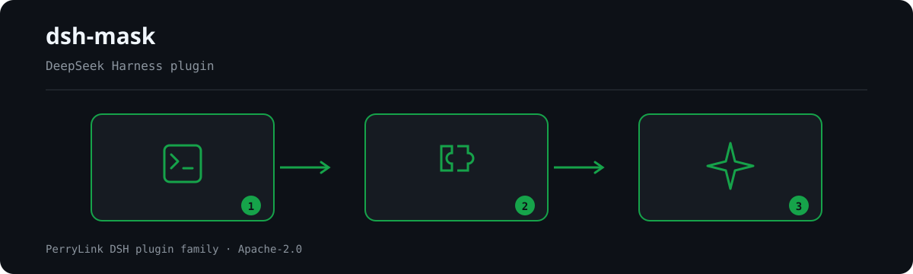

<div align="center">

# dsh-mask
- **1024 store channel**: `npm i -g dsh1024` once, then `dsh1024 plugin --profile web add dsh-mask` (counts toward the [deepseek1024.com](https://deepseek1024.com) install ranking).
[](https://gitee.com/perrylink/dsh-mask)
[](https://dshfind.com/plugins/PerryLink/dsh-mask?ref=badge)
[](https://api.securityscorecards.dev/projects/github.com/PerryLink/dsh-mask)

**PII masking middleware for DeepSeek Harness — anonymize personal data before it reaches the model, keep it reversible host-side.**

*Phones, emails, ID cards, bank cards, keys, and more become placeholders at the model boundary; the plaintext never enters your session log.*

[](LICENSE)
[](https://github.com/topics/dsh-plugin)
[](https://github.com/PerryLink/dsh-plugin-doctor#verified-徽章)
[](https://dsh.market/)
[](#)
[](https://github.com/PerryLink/dsh-mask/actions)
[](https://github.com/PerryLink/dsh-mask/releases)
[](https://www.npmjs.com/package/dsh-mask)
[](https://www.npmjs.com/package/dsh-mask)

[English](README.md) · [简体中文](README-zh.md) · [Español](README-es.md) · [Português](README-pt.md) · [हिन्दी](README-hi.md)

```sh
dsh plugin --profile <name> add dsh-mask
```


</div>

---

**📖 Ecosystem knowledge base** — measured data, not marketing: [plugin development guide · plugin-selection data · maintenance criteria](https://perrylink.github.io/dsh-plugin-guide/).

<!-- star-cta -->
## Install & uninstall

- **git channel** (latest `main`): `dsh plugin --profile web add github:PerryLink/dsh-mask` (equivalent to installing from `git+https://github.com/PerryLink/dsh-mask.git`). No build step — `index.mjs` and `lib/` are the shipped artifacts.
- **npm channel** (published releases): `dsh plugin --profile web add dsh-mask`.
- **tarball channel**: `pnpm pack` in this repo, then `dsh plugin --profile web add ./dsh-mask-<version>.tgz`.
- **uninstall**: `dsh plugin --profile web remove dsh-mask` (or remove the row from the profile patch).

`dsh-mask` no longer bundles the storage stack. Profiles that already compose it (the `web` profile does, via `@deepseek-ai/dsh-web-app`) provide `storageDomain`, so persistence works out of the box. On a bare profile without storage the plugin still mounts and masks, but the restore table is memory-only (lost on restart) — compose the storage stack in your profile patch, or set `persistRestoreTable: false`.

## ⭐ 如果它帮到了你

这个插件是 [DSH 插件家族](https://github.com/PerryLink)的一员（95 个，全部 Apache-2.0）。如果你在用，**给个 star** —— 它不会解锁任何功能，但会让下一个人在搜索里更容易找到它。

*English:* part of a 95 plugin family for DeepSeek Harness. If it is useful, **a star helps the next person find it** — nothing is gated behind it.


## What is dsh-mask?

PII masking middleware for DeepSeek Harness — anonymize personal data before it reaches the model, keep it reversible host-side.

Phones, emails, ID cards, bank cards, keys, and more become placeholders at the model boundary; the plaintext never enters your session log.



*Workflow overview: call → plugin → result. The examples below use the real command surface.*


## Comparison


108 synthetic samples (60 positive, 48 negative) · from benchmark/RESULTS.md

## Compatibility

| Surface | Status |
|---|---|
| Harness | DeepSeek Harness `dsh-v0.2.1-alpha.1` (adapted 2026-09-18): the session envelope keeps its ignorable field for stored-log read compatibility only - Session.append still cannot stamp it, so audit-gate behavior is unchanged. Verified 2026-09-18 against the dsh-v0.1.7-alpha.1 master checkout (full gate chain + profile install smoke). |
| Node | `^22.19.0 \|\| >=24.0.0` |
| Platforms | Anywhere DSH runs (pure host, zero-dependency regex; no browser half) |
| Model | Text models fully supported; no extra model capability required |

## What you get

`dsh-mask` anonymizes personal data **at the model boundary** — before a message reaches the model — and keeps a restore table host-side so placeholders stay reversible:

- **Request-time masking** — `agent/pre-step` messages are rewritten so phones, emails, ID cards, bank cards, and keys (on by default) and IPs (opt-in) become `<PHONE_1>`-style placeholders. The masked text is what gets logged and sent to the model.
- **Restore table** — the `placeholder → original` map lives only in memory and a controlled storage domain (`dsh_mask`); the plaintext never enters the session log.
- **Audit, not plaintext** — the `mask/applied` session event records only "replaced N values + type distribution", never the original text or the mapping.
- **`/mask` command** — `status` (counts + distribution), `on`/`off` (runtime toggle), `restore <text>` (unmap placeholders and deliver the plaintext as a file, never as logged text), `help`.
- **`mask_test` tool** — run a snippet through the detector and see the placeholder result; it never reveals the original values.

```text
user message ──agent/pre-step──▶ placeholders ──model──▶ placeholders ──restore──▶ controlled file
                                   ▲                                                      │
                                   └──────── restore table (memory + dsh_mask) ───────────┘
```

## Quick start

```sh
dsh plugin --profile web add github:PerryLink/dsh-mask
```

```sh
# 1. install the bundle into your profile
dsh plugin --profile web add github:PerryLink/dsh-mask

# or from npm (published releases)
dsh plugin --profile web add dsh-mask

# 2. verify the row mounts
dsh --profile web --dump-config | grep -A2 'id: mask'
```

Then tailor the entity list in your profile patch:

```yaml
- insert:
    - id: mask
      name: dsh-mask
      config:
        entities: [phone, email, id-card, bank-card, key]
```

```
> /mask status
> /mask restore <PHONE_1>
mask: restored 1 placeholder(s): <PHONE_1>
  file: /tmp/dsh-mask-restore/restore-1f0c….txt  (mode 0600, one file per session)
```

### Examples

These are the plugin's real entry points; install once, then call one.

#### Detailed example

**Command**

~~~sh
mask_test
~~~

**Input**

~~~json
{"text":"电话 13812345678"}
~~~

**Output**

~~~text
mask_test: replaced 1 PII value(s) (PHONE=1)
masked:
电话 <PHONE_1>
~~~

*Observed from `plugins/dsh-mask/index.mjs:243-250; test/index.test.mjs:306-315`*

#### Failure branch

**Input**

~~~text
/mask restore <PHONE_1> with restoreDir=/tmp/dsh-mask-probe-not-a-dir (a regular file)
~~~

**Output**

~~~text
mask: restore failed: EEXIST: file already exists, mkdir '/tmp/dsh-mask-probe-not-a-dir'
~~~

*Observed from `plugins/dsh-mask/index.mjs:501-506; plugins/dsh-mask/lib/deliver.mjs:89-97; plugins/dsh-mask/test/index.test.mjs:278-290`*

#### Brief examples

- `mask_test`
- `/mask restore <text>`

## Configuration

All tunables are Schemastery `Config` fields (changeable from cordis.yml). An id-targeted override replaces the whole row — restate every key you need. `cordis.patch.yml` documents each key inline.

| Key | Default | Meaning |
|---|---|---|
| `enabled` | `true` | Master switch; `false` unregisters the listener, the `/mask` command, and the `mask_test` tool |
| `mode` | `regex` | Detection mode; only `regex` is implemented (`regex+ner` for name/address recognition is reserved and fails loud) |
| `entities` | `[phone, email, id-card, bank-card, key]` | Which PII types to mask; `ip` is also regex-capable (opt-in), `person`/`address` require NER |
| `scope` | `[messages]` | Masking surface(s); `messages` masks agent/pre-step messages, `tools` masks tool-result text on tools/post-execute. Accepts a string or an array, e.g. `[messages, tools]` |
| `registerCommand` | `true` | Register the `/mask` command |
| `registerTools` | `true` | Register the `mask_test` tool when the tools service is present |
| `persistRestoreTable` | `true` | Persist the restore table to the controlled `dsh_mask` storage domain (`false` = memory only) |
| `maxRestoreEntriesPerSession` | `500` | Per-session restore entry cap (oldest evicted first) |
| `maxSessions` | `1000` | In-memory session cap (least-recently-used evicted, mapping reloaded on demand) |
| `maskClientEnabled` | `false` | Feature flag for the browser half "reveal" bubble (defensive; off by default until the live slot catalog verifies the target slot). The key is schema-declared and validated, but no runtime code reads it yet, so it changes nothing until the browser half ships |
| `restoreDir` | `''` | Where `/mask restore` delivers the restored plaintext. Empty = `os.tmpdir()/dsh-mask-restore`; a relative value resolves against the host process working directory. The directory is created `0700` and the file written `0600`, one file per session |

Example override in your profile patch:

```yaml
- insert:
    - id: mask
      name: dsh-mask
      config:
        entities: [phone, email, id-card, bank-card, key, ip]
        persistRestoreTable: false
        registerCommand: true
```

## Tools & surfaces

| Surface | Reveals plaintext | Notes |
|---|---|---|
| `agent/pre-step` masking | never | Rewrites messages to placeholders before they are logged or sent to the model |
| `tools/post-execute` masking | never | Rewrites tool-result text blocks to placeholders before they are logged or fed back to the model (scope: `tools`) |
| `/mask status` | never | Enabled state, total replaced, type distribution |
| `/mask on` / `/mask off` | never | Runtime toggle (resets to `config.enabled` on restart) |
| `/mask restore <text>` | yes (explicit) | Unmaps placeholders back to the values stored for this session and writes them to a controlled file (one per session, mode `0600`); the result text and the session log carry only that path and the placeholder names |
| `mask_test` | never | Masks a snippet and reports the placeholder result + counts |

## Permissions & data

- **Permissions**: `dsh-mask` performs no network requests and stores no credentials; it reads the session at the `agent/pre-step` boundary, writes its own `dsh_mask` storage domain, and writes the `/mask restore` delivery file (the manifest declares `filesystem:write` for exactly that). The `dshWorkshop` manifest also declares `network:none` and `credentials:none`.
- **Data**: the `placeholder → original` restore table lives in memory and, when `persistRestoreTable: true`, in the controlled `dsh_mask` storage domain — it is never written to the session log. The only other plaintext copy is the delivery file an explicit `/mask restore` writes under `restoreDir` (mode `0600`, one file per session, overwritten by the next restore); nothing writes plaintext to disk implicitly.
- **Session log**: `mask/applied` is declared in `types.d.ts` and appended only when the host records the type (see Known limitations). Its payload is counts + type distribution only.

## Security boundaries

- **Plaintext never enters the session log.** The masked (placeholder) form is what gets logged and sent to the model, so model-visible content is reconstructable from the log in placeholder form; the originals stay in the restore table. The same rule governs the reveal direction: a command's result text is logged **verbatim** by the host and rendered from that same event, so `/mask restore` writes the plaintext to a controlled file and returns only its path.
- **Sanitize before display/log.** `lib/sanitize.mjs` redacts PII, secrets, and URL credentials before any text reaches the model or the log; `mask_test`, `/mask status`, and every `/mask` error path never echo originals.
- **Controlled restore.** `/mask restore` is the single explicit reveal surface, and it only reads the mapping for the active session. Failure fails closed: if the delivery file cannot be written, the command reports an error and never falls back to echoing the plaintext.
- **Fail closed.** Unimplemented `mode` (`regex+ner`), unknown `scope` values, NER-only entities, and out-of-bounds numbers all fail loudly at load.
- **Registrations are effects.** The listener, command, tool, and storage-domain close are all Cordis effects — stop/hot-reload removes them.

## Known limitations

- **Regex only.** Name (`person`) and address (`address`) recognition needs an external NER recognizer, which the pure-host zero-dependency form does not bundle; `mode: regex+ner` and those entities fail loudly at load. The PII types covered out of the box are phone, email, ID card, bank card, key, and (opt-in) IP.
- **Region-specific patterns.** The `phone` and `id-card` detectors match mainland-China formats only: `phone` is `1[3-9]` followed by nine digits, and `id-card` is an 18-character Chinese resident ID (17 digits plus a digit or `X`). Phone numbers and national identifiers from other countries are not detected. `email`, `ip`, and `key` are region-agnostic; `bank-card` accepts any 16-19 digit run at a lower confidence score.
- **Display-layer restore needs a client half.** Masking is fully host-side, but transparently un-masking the assistant bubbles in the client UI is a browser-half feature this pure-host form does not ship. The host side keeps the restore table and the exported `RestoreStore` seam (its methods take a session id), so a future client half would reach them through a host remote rather than directly; today the unmasking surface is the `/mask restore <text>` command, which delivers the plaintext as a file because a command result is logged verbatim (see Security boundaries), and the `maskClientEnabled` key is validated but read by no runtime code yet.
- **No no-argument `/mask restore`.** Restoring *every* placeholder of the most recent assistant message is not offered, and the command says so when invoked without text. Two host facts block it: the restore table is a flat per-session `{placeholder: original}` map with no per-message index, so that message has to be located in the session event log; and the host deprecated `Session.snapshotEvents()` / `eventAt()` / `ownEvents()` with an explicit "new calls are prohibited", leaving an incremental projection as the only sanctioned route — which this plugin's declared host corridor (`>=0.1.2-rc.1`) cannot rely on. Placeholders keep working one at a time instead: `/mask restore <PHONE_1>`.
- **Session events on `0.1.7-rc.2`.** The harness records 59 session event types and none of them is `mask/*`; its `Session.append` also cannot stamp the `ignorable` envelope, so the session-log audit appends are skipped and sessions keep loading. The gate is not silent about it: the first refusal per session logs one visible warning naming the skipped type and this documented limitation. The plugin enables the append automatically once a host records the type or supports the `ignorable` envelope.

## Development

```sh
pnpm install                                       # node ^22.19 || >=24
pnpm run typecheck && pnpm run typecheck:ci        # two rulers: checkout face (guarded; unverifiable without the checkout) + published-line face
pnpm test                                          # node --test
pnpm run verify:self-contained                     # dependency specs resolve from the registry
pnpm run verify:artifacts                          # shipped files present + index.mjs importable
pnpm run check:readmes                             # five-language README consistency
pnpm pack                                          # the published tarball
```

There is no build step: pure ESM, `index.mjs` and `lib/` are the shipped artifacts.

### Benchmark

The PII benchmark (per-type P/R/F1 over 108 synthetic samples) is published in [`benchmark/RESULTS.md`](benchmark/RESULTS.md); regenerate it with `node benchmark/run.mjs` (no build step, zero new dependencies).

## Interoperability with other DSH plugins

Verified against **DSH `0.2.0-rc.2`** (the runtime this README ships for) and the high-star plugin set surveyed on 2026-10-05.

This plugin **does not interfere** with other plugins, including the widely installed high-star ones:

- **No tool-name collision.** Every tool is namespaced; no bare name owned by a shipped tool or another plugin is registered.
- **No service-key collision.** It provides no service key at all, so it cannot collide on one.
- **No slot collision.** It registers no client slot key, so it cannot contend for a `shadows-shipped-ui` seat.
- **No HTTP route collision.** It registers no `webServer` prefix.
- **No patch-layer collision.** The bundle patch only `insert`s its own row; it never overrides a built-in row's `config`.
- **No global mutation.** It does not patch prototypes, rewrite `process.env`, or replace the global fetch dispatcher.

**Shared event listeners are non-interfering by construction.** It observes the ordering-sensitive events `agent/pre-step`, `tools/post-execute` with `ctx.on()` — Cordis's broadcast registration, where every listener runs and none can starve another. **Every listener here delegates through `next()`**, so the chain is never short-circuited, and a mutation is applied to the value `next()` produced rather than returned in its place:
  - `agent/pre-step` — also used by `dsh-routing-suite` (7000★, 7 listeners), `modlens` (4122★), `dsh-purge` (3317★), `dsh-agent-teams` (1923★), `dsh-context` (1849★).
  - `tools/post-execute` — also used by `cc-safety-net` (1576★).

Static evidence: `dsh-plugin-doctor` K10–K13 report `pass` for every check on this repository.

## Topics

`dsh`, `dsh-plugin`, `deepseek-harness`, `deepseek`, `cordis`, `pii`, `mask`, `privacy`, `anonymization`, `security`

## Contributors

- [@PerryLink](https://github.com/PerryLink) — creator and maintainer: the regex PII detector ported from Pii-Stripper-Middleware, the `agent/pre-step` masking seam, the restore table, the `/mask` command and `mask_test` tool, and the five-language docs.

## PerryLink DSH Plugin Family

This project is part of the DeepSeek Harness plugin family from [PerryLink](https://github.com/PerryLink). The roster stays collapsed below so every README keeps a short first screen; expand it to see every row and its status.

<details>
<summary>Expand all plugins</summary>

| Plugin | Status |
|---|---|
| **[dsh-aqua-input-check](https://github.com/PerryLink/dsh-aqua-input-check)** |  |
| **[dsh-archive-check](https://github.com/PerryLink/dsh-archive-check)** |  |
| **[dsh-auto-review](https://github.com/PerryLink/dsh-auto-review)** |  |
| **[dsh-autotier](https://github.com/PerryLink/dsh-autotier)** |  |
| **[dsh-bid-ca-precheck](https://github.com/PerryLink/dsh-bid-ca-precheck)** |  |
| **[dsh-bid-qual-check](https://github.com/PerryLink/dsh-bid-qual-check)** |  |
| **[dsh-cert-mcp](https://github.com/PerryLink/dsh-cert-mcp)** |  |
| **[dsh-checkpoint-rewind](https://github.com/PerryLink/dsh-checkpoint-rewind)** |  |
| **[dsh-click](https://github.com/PerryLink/dsh-click)** |  |
| **[dsh-composer-history](https://github.com/PerryLink/dsh-composer-history)** |  |
| **[dsh-contract-stance](https://github.com/PerryLink/dsh-contract-stance)** |  |
| **[dsh-customs-doc-check](https://github.com/PerryLink/dsh-customs-doc-check)** |  |
| **[dsh-data-quality](https://github.com/PerryLink/dsh-data-quality)** |  |
| **[dsh-demurrage-ledger](https://github.com/PerryLink/dsh-demurrage-ledger)** |  |
| **[dsh-doublecheck](https://github.com/PerryLink/dsh-doublecheck)** |  |
| **[dsh-drill-script-check](https://github.com/PerryLink/dsh-drill-script-check)** |  |
| **[dsh-eia-guide-check](https://github.com/PerryLink/dsh-eia-guide-check)** |  |
| **[dsh-emergency-plan](https://github.com/PerryLink/dsh-emergency-plan)** |  |
| **[dsh-essay-rubric-check](https://github.com/PerryLink/dsh-essay-rubric-check)** |  |
| **[dsh-evidence-check](https://github.com/PerryLink/dsh-evidence-check)** |  |
| **[dsh-export-ctl-check](https://github.com/PerryLink/dsh-export-ctl-check)** |  |
| **[dsh-fast](https://github.com/PerryLink/dsh-fast)** |  |
| **[dsh-fmea-table-check](https://github.com/PerryLink/dsh-fmea-table-check)** |  |
| **[dsh-forecast-penalty](https://github.com/PerryLink/dsh-forecast-penalty)** |  |
| **[dsh-fund-research](https://github.com/PerryLink/dsh-fund-research)** |  |
| **[dsh-github](https://github.com/PerryLink/dsh-github)** |  |
| **[dsh-gongwen-flow-check](https://github.com/PerryLink/dsh-gongwen-flow-check)** |  |
| **[dsh-gongwen-word-check](https://github.com/PerryLink/dsh-gongwen-word-check)** |  |
| **[dsh-guard-plan-qc](https://github.com/PerryLink/dsh-guard-plan-qc)** |  |
| **[dsh-hazchem-check](https://github.com/PerryLink/dsh-hazchem-check)** |  |
| **[dsh-hazplan-check](https://github.com/PerryLink/dsh-hazplan-check)** |  |
| **[dsh-hidden-risk-map](https://github.com/PerryLink/dsh-hidden-risk-map)** |  |
| **[dsh-hs-classify](https://github.com/PerryLink/dsh-hs-classify)** |  |
| **[dsh-icd-rule-check](https://github.com/PerryLink/dsh-icd-rule-check)** |  |
| **[dsh-industry-research](https://github.com/PerryLink/dsh-industry-research)** |  |
| **[dsh-lawcite-adapter](https://github.com/PerryLink/dsh-lawcite-adapter)** |  |
| **[dsh-laya](https://github.com/PerryLink/dsh-laya)** |  |
| **[dsh-lc-doc-check](https://github.com/PerryLink/dsh-lc-doc-check)** |  |
| **[dsh-learning-gap-check](https://github.com/PerryLink/dsh-learning-gap-check)** |  |
| **[dsh-library](https://github.com/PerryLink/dsh-library)** |  |
| **[dsh-local-ai](https://github.com/PerryLink/dsh-local-ai)** |  |
| **[dsh-lsp-actions](https://github.com/PerryLink/dsh-lsp-actions)** |  |
| **[dsh-mask](https://github.com/PerryLink/dsh-mask)** |  |
| **[dsh-mcp-panel](https://github.com/PerryLink/dsh-mcp-panel)** |  |
| **[dsh-medrec-qc](https://github.com/PerryLink/dsh-medrec-qc)** |  |
| **[dsh-memento](https://github.com/PerryLink/dsh-memento)** |  |
| **[dsh-nsfc-form-check](https://github.com/PerryLink/dsh-nsfc-form-check)** |  |
| **[dsh-nurse-record-check](https://github.com/PerryLink/dsh-nurse-record-check)** |  |
| **[dsh-observe](https://github.com/PerryLink/dsh-observe)** |  |
| **[dsh-origin-rvc-check](https://github.com/PerryLink/dsh-origin-rvc-check)** |  |
| **[dsh-ota-review-check](https://github.com/PerryLink/dsh-ota-review-check)** |  |
| **[dsh-output-styles](https://github.com/PerryLink/dsh-output-styles)** |  |
| **[dsh-paper-doc-adapter](https://github.com/PerryLink/dsh-paper-doc-adapter)** |  |
| **[dsh-permission-rules](https://github.com/PerryLink/dsh-permission-rules)** |  |
| **[dsh-permit-report-check](https://github.com/PerryLink/dsh-permit-report-check)** |  |
| **[dsh-pipeline-check](https://github.com/PerryLink/dsh-pipeline-check)** |  |
| **[dsh-pleading-draft](https://github.com/PerryLink/dsh-pleading-draft)** |  |
| **[dsh-plugin-doctor](https://github.com/PerryLink/dsh-plugin-doctor)** |  |
| **[dsh-plugin-guide](https://github.com/PerryLink/dsh-plugin-guide)** |  |
| **[dsh-plugin-kit](https://github.com/PerryLink/dsh-plugin-kit)** |  |
| **[dsh-plugin-upgrade](https://github.com/PerryLink/dsh-plugin-upgrade)** |  |
| **[dsh-policy-brief-draft](https://github.com/PerryLink/dsh-policy-brief-draft)** |  |
| **[dsh-power-loss-split](https://github.com/PerryLink/dsh-power-loss-split)** |  |
| **[dsh-power-ticket-check](https://github.com/PerryLink/dsh-power-ticket-check)** |  |
| **[dsh-ppap-check](https://github.com/PerryLink/dsh-ppap-check)** |  |
| **[dsh-protest-deadline](https://github.com/PerryLink/dsh-protest-deadline)** |  |
| **[dsh-railway-window](https://github.com/PerryLink/dsh-railway-window)** |  |
| **[dsh-repair-order-qc](https://github.com/PerryLink/dsh-repair-order-qc)** |  |
| **[dsh-research-report](https://github.com/PerryLink/dsh-research-report)** |  |
| **[dsh-review-reply-check](https://github.com/PerryLink/dsh-review-reply-check)** |  |
| **[dsh-rulefile-check](https://github.com/PerryLink/dsh-rulefile-check)** |  |
| **[dsh-safety-brief-check](https://github.com/PerryLink/dsh-safety-brief-check)** |  |
| **[dsh-score](https://github.com/PerryLink/dsh-score)** |  |
| **[dsh-session-sync](https://github.com/PerryLink/dsh-session-sync)** |  |
| **[dsh-site-log-check](https://github.com/PerryLink/dsh-site-log-check)** |  |
| **[dsh-skill-pack-security](https://github.com/PerryLink/dsh-skill-pack-security)** |  |
| **[dsh-soe-decision-check](https://github.com/PerryLink/dsh-soe-decision-check)** |  |
| **[dsh-soilwater-check](https://github.com/PerryLink/dsh-soilwater-check)** |  |
| **[dsh-sop-sync-check](https://github.com/PerryLink/dsh-sop-sync-check)** |  |
| **[dsh-spc-gbt-adapter](https://github.com/PerryLink/dsh-spc-gbt-adapter)** |  |
| **[dsh-talk](https://github.com/PerryLink/dsh-talk)** |  |
| **[dsh-tender-extract](https://github.com/PerryLink/dsh-tender-extract)** |  |
| **[dsh-tender-matrix](https://github.com/PerryLink/dsh-tender-matrix)** |  |
| **[dsh-test-drive](https://github.com/PerryLink/dsh-test-drive)** |  |
| **[dsh-ticktick](https://github.com/PerryLink/dsh-ticktick)** |  |
| **[dsh-translate](https://github.com/PerryLink/dsh-translate)** |  |
| **[dsh-warranty-calc](https://github.com/PerryLink/dsh-warranty-calc)** |  |
| **[dsh-budget](https://github.com/PerryLink/dsh-budget)** | 🧊 FROZEN — see the repo README |
| **[dsh-claude-move](https://github.com/PerryLink/dsh-claude-move)** | 🧊 FROZEN — see the repo README |
| **[dsh-defend](https://github.com/PerryLink/dsh-defend)** | 🧊 FROZEN — see the repo README |
| **[dsh-draw](https://github.com/PerryLink/dsh-draw)** | 🧊 FROZEN — see the repo README |
| **[dsh-reach](https://github.com/PerryLink/dsh-reach)** | 🧊 FROZEN — see the repo README |
| **[dsh-background-agents](https://github.com/PerryLink/dsh-background-agents)** | 🚫 RETIRED — see the repo README |
| **[dsh-session-pin](https://github.com/PerryLink/dsh-session-pin)** | 🚫 RETIRED — see the repo README |
| **[dsh-team-rooms](https://github.com/PerryLink/dsh-team-rooms)** | 🚫 RETIRED — see the repo README |

</details>

## License

[LICENSE](LICENSE) (Apache License 2.0) © 2026 dsh-mask contributors
