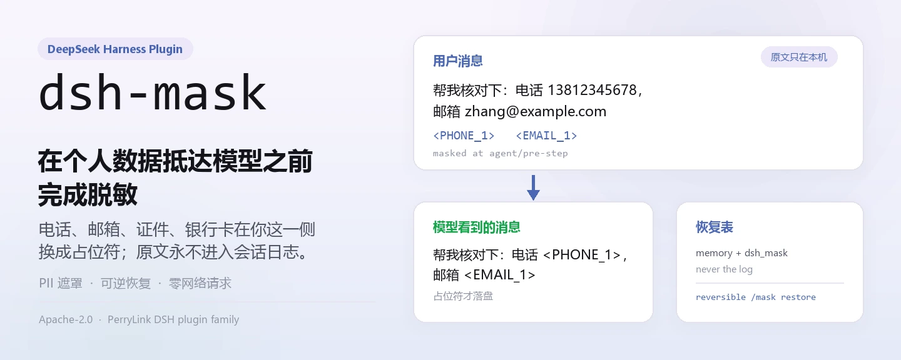
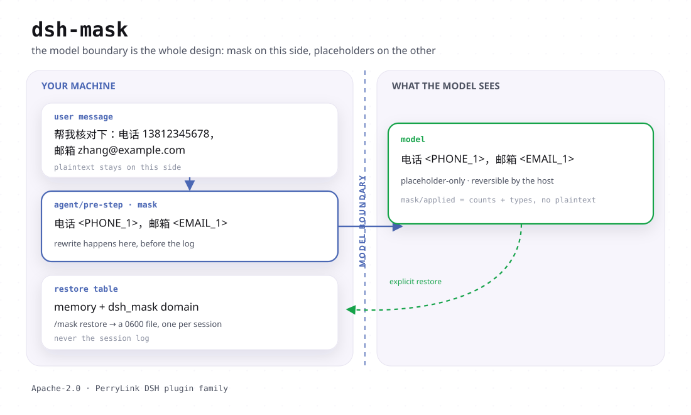
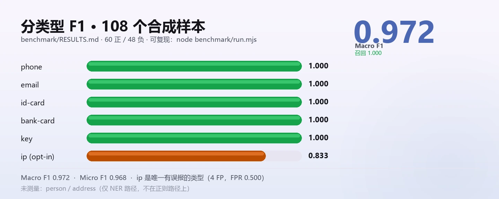

<div align="center">

<picture>
  <source media="(prefers-color-scheme: dark)" srcset="docs/assets/hero-zh-dark-v3.webp">
  
</picture>

# dsh-mask

**在个人数据抵达模型之前完成脱敏——原文永不进入会话日志。**

面向 DeepSeek Harness 的纯主机端 PII 遮罩中间件：电话、邮箱、身份证、银行卡、密钥在模型边界变成占位符，恢复表只留在你自己的机器上。

[安装](#三步上手) · [配置](#配置) · [FAQ](#faq) · [简体中文](README.md) · [English](README.en.md) · [Español](README.es.md) · [Português](README.pt.md) · [हिन्दी](README.hi.md)

[](LICENSE)
[](#兼容性)
[](https://www.npmjs.com/package/dsh-mask)
[](https://github.com/PerryLink/dsh-mask/actions/workflows/ci.yml)
[](#兼容性)

[](https://github.com/PerryLink/dsh-mask/stargazers)
[](https://www.npmjs.com/package/dsh-mask)
[](https://dshfind.com/plugins/PerryLink/dsh-mask?ref=badge)
[](https://securityscorecards.dev/viewer/?uri=github.com/PerryLink/dsh-mask)
[](https://dsh.market/)
[](https://gitee.com/perrylink/dsh-mask)

```sh
dsh plugin --profile <name> add dsh-mask
```

</div>

<sub>社区插件，与 DeepSeek 官方无关。唯一仓库：<https://github.com/PerryLink/dsh-mask>（Gitee 为镜像）。</sub>

## 它是什么

发消息给模型之前，`dsh-mask` 先把里面的电话、邮箱、身份证、银行卡、密钥换成 `<PHONE_1>` 这样的占位符——模型看到的、会话日志记下的，都只有占位符。真正的原文只存在主机侧的恢复表里（内存 + 受控的 `dsh_mask` 存储域），随时可以调用 `/mask restore` 显式取回：原文以 `0600` 权限的文件交付，路径才进日志。纯正则、零依赖、无网络请求。

<picture>
  <source media="(prefers-color-scheme: dark)" srcset="docs/assets/dsh-mask-flow-v4-dark.svg">
  
</picture>

## 三步上手

1. **安装**（三选一）：

   ```sh
   # git 通道（最新 main；等价于 git+https://github.com/PerryLink/dsh-mask.git）
   dsh plugin --profile web add github:PerryLink/dsh-mask
   # npm 通道（已发布版本）
   dsh plugin --profile web add dsh-mask
   # tarball 通道：本仓库 pnpm pack 后
   dsh plugin --profile web add ./dsh-mask-<version>.tgz
   ```

   无构建步骤——`index.mjs` 与 `lib/` 即发布产物。

2. **最小配置**（默认即可用；按需调整实体列表）：

   ```yaml
   - insert:
       - id: mask
         name: dsh-mask
         config:
           entities: [phone, email, id-card, bank-card, key]
   ```

3. **验证已生效**：

   ```sh
   dsh --profile web --dump-config | grep -A2 'id: mask'
   ```

   ```
   > /mask status
   > /mask restore <PHONE_1>
   mask: restored 1 placeholder(s): <PHONE_1>
     file: /tmp/dsh-mask-restore/restore-1f0c….txt  (mode 0600, one file per session)
   ```

**卸载**：`dsh plugin --profile web remove dsh-mask`（或从 profile patch 删掉该行）。

> `dsh-mask` 不自带 storage 栈。已组合该栈的 profile（`web` profile 通过 `@deepseek-ai/dsh-web-app` 提供）自带 `storageDomain`，持久化开箱即用；未组合 storage 的 bare profile 仍可正常挂载与遮罩，但恢复表仅存内存（重启丢失）——请在 profile patch 中组合 storage 栈，或将 `persistRestoreTable` 设为 `false`。

<details>
<summary>从 DSH Desktop 市场安装</summary>

所有 PerryLink 插件均可在 DSH Desktop 内置市场中浏览：**市场 → 来源 → 添加来源 → 粘贴** `https://perrylink-dsh-catalog.perrylink.workers.dev/catalog-source.json` **→ 选中**。安装仍需通过市场的 npm 身份校验与你的确认。

</details>

## 核心能力

`dsh-mask` 在**模型边界**匿名化个人数据——消息进入模型之前——并维护一张恢复表，让占位符可逆：

- **请求前遮罩** —— 重写 `agent/pre-step` 消息，使电话、邮箱、身份证、银行卡、密钥（默认开启）与 IP（可选）变成 `<PHONE_1>` 之类的占位符。被遮罩的文本才是落盘并发送给模型的内容。
- **恢复表** —— `占位符 → 原文` 映射只存内存与受控 storage domain（`dsh_mask`）；原文绝不进会话日志。
- **审计不含明文** —— `mask/applied` 会话事件只记「替换了 N 处 + 类型分布」，不记原文与映射。
- **`/mask` 命令** —— `status`（计数 + 分布）、`on`/`off`（运行时开关）、`restore <text>`（还原占位符，原文交付为文件而非可记录的文本）、`help`。
- **`mask_test` 工具** —— 试跑一段文本看替换效果；绝不回显原文。

```text
用户消息 ──agent/pre-step──▶ 占位符 ──模型──▶ 占位符 ──restore──▶ 受控文件
                               ▲                                        │
                               └──── 恢复表（内存 + dsh_mask）──────────┘
```

### 命令与工具面

| 表面 | 是否回显原文 | 说明 |
|---|---|---|
| `agent/pre-step` 遮罩 | 永不 | 把消息重写为占位符后再落盘/送模型 |
| `tools/post-execute` 遮罩 | 永不 | 把工具结果文本重写为占位符后再落盘/回喂模型（`scope: tools`） |
| `/mask status` | 永不 | 启用状态、替换总数、类型分布 |
| `/mask on` / `/mask off` | 永不 | 运行时开关（重启回到 `config.enabled`） |
| `/mask restore <text>` | 是（显式） | 把占位符还原为本会话存储的值并写进受控文件（每会话一个，mode `0600`）；结果文本与会话日志只带该路径与占位符名 |
| `mask_test` | 永不 | 遮罩一段文本并报告占位符结果 + 计数 |

### 示例

以下为插件真实入口；安装后调用一个即可。

**详细示例** — 命令 `mask_test`，输入：

```json
{"text":"电话 13812345678"}
```

输出：

```text
mask_test: replaced 1 PII value(s) (PHONE=1)
masked:
电话 <PHONE_1>
```

*Observed from `plugins/dsh-mask/index.mjs:243-250; test/index.test.mjs:306-315`*

**失败分支** — 输入：

```text
/mask restore <PHONE_1> with restoreDir=/tmp/dsh-mask-probe-not-a-dir (a regular file)
```

输出：

```text
mask: restore failed: EEXIST: file already exists, mkdir '/tmp/dsh-mask-probe-not-a-dir'
```

*Observed from `plugins/dsh-mask/index.mjs:501-506; plugins/dsh-mask/lib/deliver.mjs:89-97; plugins/dsh-mask/test/index.test.mjs:278-290`*

**简短示例**：`mask_test` · `/mask restore <text>`

## 实测数据

<picture>
  <source media="(prefers-color-scheme: dark)" srcset="docs/assets/dsh-mask-evidence-v3-zh-dark.webp">
  
</picture>

108 个合成样本（60 正 / 48 负）的逐类 P/R/F1 基准见 [`benchmark/RESULTS.md`](benchmark/RESULTS.md)，可用 `node benchmark/run.mjs` 复现（无需构建、零新依赖）。该基准只覆盖正则路径：仅形状校验、不验校验位，`ip` 正则按范围宽松匹配（因此有误报），`person`/`address` 不在测量范围。

## 配置

所有可调项都是 Schemastery `Config` 字段（可从 cordis.yml 覆盖）。按 id 覆盖会替换整行——请重述所有需要的键。`cordis.patch.yml` 逐键内联注释。

最常用键：

| 键 | 默认值 | 含义 |
|---|---|---|
| `enabled` | `true` | 总开关；`false` 卸载监听器、`/mask` 命令与 `mask_test` 工具 |
| `mode` | `regex` | 检测模式；只有 `regex` 实现（`regex+ner` 姓名/地址识别预留并响亮失败） |
| `entities` | `[phone, email, id-card, bank-card, key]` | 要遮罩的 PII 类型；`ip` 也支持正则（可选），`person`/`address` 需要 NER |
| `scope` | `[messages]` | 遮罩作用域；`messages` 遮罩 agent/pre-step 消息，`tools` 遮罩 tools/post-execute 工具结果。可为字符串或数组，如 `[messages, tools]` |
| `persistRestoreTable` | `true` | 把恢复表持久化到受控 `dsh_mask` 领域（`false` = 仅内存） |
| `restoreDir` | `''` | `/mask restore` 交付原文的位置。空 = `os.tmpdir()/dsh-mask-restore`；相对值相对宿主进程 cwd 解析。目录按 `0700` 创建、文件按 `0600` 写入，每会话一个文件 |

<details>
<summary>完整配置表（11 个键）</summary>

| 键 | 默认值 | 含义 |
|---|---|---|
| `enabled` | `true` | 总开关；`false` 卸载监听器、`/mask` 命令与 `mask_test` 工具 |
| `mode` | `regex` | 检测模式；只有 `regex` 实现（`regex+ner` 姓名/地址识别预留并响亮失败） |
| `entities` | `[phone, email, id-card, bank-card, key]` | 要遮罩的 PII 类型；`ip` 也支持正则（可选），`person`/`address` 需要 NER |
| `scope` | `[messages]` | 遮罩作用域；`messages` 遮罩 agent/pre-step 消息，`tools` 遮罩 tools/post-execute 工具结果。可为字符串或数组，如 `[messages, tools]` |
| `registerCommand` | `true` | 注册 `/mask` 命令 |
| `registerTools` | `true` | tools 服务存在时注册 `mask_test` 工具 |
| `persistRestoreTable` | `true` | 把恢复表持久化到受控 `dsh_mask` 领域（`false` = 仅内存） |
| `maxRestoreEntriesPerSession` | `500` | 每会话恢复条目上限（最旧先逐出） |
| `maxSessions` | `1000` | 内存会话上限（LRU 逐出，映射按需回载） |
| `maskClientEnabled` | `false` | 浏览器半「显示原文」气泡的功能开关（防御性，默认关闭，直到线上 slot 目录验证目标 slot）。该键已由 schema 声明并校验，但尚无运行时代码读取它——在浏览器半交付前它不改变任何行为 |
| `restoreDir` | `''` | `/mask restore` 交付原文的位置。空 = `os.tmpdir()/dsh-mask-restore`；相对值相对宿主进程 cwd 解析。目录按 `0700` 创建、文件按 `0600` 写入，每会话一个文件 |

</details>

profile patch 覆盖示例：

```yaml
- insert:
    - id: mask
      name: dsh-mask
      config:
        entities: [phone, email, id-card, bank-card, key, ip]
        persistRestoreTable: false
        registerCommand: true
```

## FAQ

<details>
<summary>原文到底存在哪？会不会被写进日志？</summary>

`占位符 → 原文` 恢复表只存内存；`persistRestoreTable: true` 时另存受控 `dsh_mask` 存储域——**绝不写会话日志**。唯一另一份原文副本是显式 `/mask restore` 写下的交付文件（`restoreDir`，mode `0600`，每会话一个，下次还原覆盖）；没有任何路径会隐式把原文写盘。

</details>

<details>
<summary>宿主不支持时会怎样？会静默失效吗？</summary>

不会静默。裸 profile 无 storage 栈时插件照常挂载与遮罩，恢复表降级为仅内存并给一次性告警；宿主不收录 `mask/applied` 事件类型时，审计 append 被跳过、每个会话首次拒绝打一条可见告警；`mode: regex+ner`、NER 实体、未知 `scope`、越界数值都在加载期响亮失败。

</details>

<details>
<summary>会和其他插件抢命令名、事件或 slot 吗？</summary>

不会。工具全部带命名空间、不提供任何服务键、不注册客户端 slot、不注册 `webServer` 前缀、不改全局对象；共享事件一律经 `next()` 委托，绝不短路链条。逐条论证见「与其他 DSH 插件的互操作性」。

</details>

<details>
<summary>性能开销多大？</summary>

检测器是零依赖纯正则、无网络请求、无模型调用，挂在 `agent/pre-step` 上同步重写消息文本。准确性实测见「实测数据」一节（108 样本，Macro F1 0.972）。

</details>

## 安全边界

- **原文绝不进会话日志。** 落盘并送模型的是遮罩（占位符）形式，因此模型可见内容可自日志以占位符形式重建；原文留在恢复表。还原方向同理：宿主把命令结果文本**原样**写进日志、并从那一条事件渲染用户可见输出，所以 `/mask restore` 把原文写进受控文件，只回路径。
- **展示/日志前脱敏。** `lib/sanitize.mjs` 在文本进入模型或日志前打码 PII、密钥与 URL 凭据；`mask_test`、`/mask status` 与所有 `/mask` 错误路径永不回显原文。
- **受控还原。** `/mask restore` 是唯一的显式还原面，且只读当前会话的映射。失败关闭：交付文件写不出时命令报错，绝不回退成回显原文。
- **失败关闭。** 未实现的 `mode`（`regex+ner`）、未知 `scope` 值、NER 实体与越界数值均在加载期响亮失败。
- **注册即 effect。** 监听器、命令、工具与领域关闭都是 Cordis effect——停止/热重载即可撤销。

## 权限与数据

- **权限**：`dsh-mask` 不做网络请求、不存凭据；只在 `agent/pre-step` 边界读取会话，写入自己的 `dsh_mask` 领域，并写入 `/mask restore` 的交付文件（manifest 正是为此声明 `filesystem:write`）。`dshWorkshop` manifest 还声明 `network:none` 与 `credentials:none`。
- **数据**：恢复表的存放与交付文件规则见上方 FAQ 第一条，结论不变——原文绝不写会话日志。
- **会话日志**：`mask/applied` 在 `types.d.ts` 声明，仅在宿主收录该类型时 append（见「已知限制」）。载荷只有计数 + 类型分布。

## 已知限制

- **仅正则。** 姓名（`person`）与地址（`address`）识别需要外部 NER 识别器，纯 host 零依赖形态未捆绑；`mode: regex+ner` 与这些实体在加载期响亮失败。开箱即用覆盖电话、邮箱、身份证、银行卡、密钥与（可选）IP。
- **正则具地域局限。** `phone` 与 `id-card` 只匹配中国大陆格式：`phone` 为 `1[3-9]` 加九位数字，`id-card` 为 18 位中国居民身份证（17 位数字加一位数字或 `X`）。其他国家的电话号码与证件号码不会被检出。`email`、`ip`、`key` 与地域无关；`bank-card` 以较低置信度接受任意 16-19 位数字串。
- **展示层还原需要浏览器半。** 遮罩完全在 host 侧，但客户端 UI 中透明还原助手气泡属于浏览器半功能，本纯 host 形态未交付。host 侧保留恢复表与已导出的 `RestoreStore` seam（其方法需要会话 id），因此未来的客户端半需经 host 远程面间接消费，而非直接使用；当前的反遮罩入口是 `/mask restore <text>` 命令，它把原文交付为文件（因为命令结果会被原样记入日志，见「安全边界」）；`maskClientEnabled` 键会被 schema 声明与校验，但尚无任何运行时代码读取它。
- **不提供无参 `/mask restore`。** 「还原最近一条助手消息里的全部占位符」这一形态未提供，且无参调用时命令会明确说明。两个宿主事实挡住了它：恢复表是每会话扁平的 `{占位符: 原文}` 映射、**没有按消息的索引**，因此必须去会话事件日志里定位那条消息；而宿主已把 `Session.snapshotEvents()` / `eventAt()` / `ownEvents()` 标为 deprecated 并明令**禁止新调用方**，其唯一被认可的替代（按投递事件增量维护投影）又超出本插件声明的宿主走廊（`>=0.1.2-rc.1`）所能依赖的范围。占位符仍可逐个还原：`/mask restore <PHONE_1>`。
- **`0.1.7-rc.2` 会话事件。** 宿主收录 59 个会话事件类型，其中没有 `mask/*`；其 `Session.append` 也无法盖章 `ignorable` 信封，因此会话日志审计 append 被跳过（会话仍可加载）。门控不再静默：每个会话首次被拒时打一条可见告警，写明被跳过的事件类型与本限制。宿主收录该类型或支持 `ignorable` 信封后自动开启。

## 与其他 DSH 插件的互操作性

已对照 **DSH `0.2.0-rc.2`**（本 README 面向的运行时）与 2026-10-05 实测的高星插件集验证。

本插件**不干扰**其他插件，包括广泛安装的高星插件：

- **无工具名冲突。** 所有工具都带命名空间，不占用任何已被内置工具或其他插件持有的裸名。
- **无服务键冲突。** 不提供任何服务键，因此不存在服务键冲突。
- **无 slot 冲突。** 不注册客户端 slot key，因此不参与 `shadows-shipped-ui` 座位争抢。
- **无 HTTP 路由冲突。** 不注册任何 `webServer` 前缀。
- **无 patch 层冲突。** 组合包 patch 只 `insert` 自己那一行，从不覆写内置行的 `config`。
- **无全局改写。** 不改原型、不改写 `process.env`、不替换全局 fetch dispatcher。

**共享事件监听器在构造上就不互相干扰。** 它用 `ctx.on()` 监听顺序敏感事件 `agent/pre-step`、`tools/post-execute` —— Cordis 的**广播**语义：每个监听器都会运行，任何一个都无法饿死其他监听器。**此处每个监听器都通过 `next()` 委托**，因此链条绝不会被短路；改写作用在 `next()` 产出的值上，而不是用它顶替返回：

- `agent/pre-step` — also used by `dsh-routing-suite` (7000★, 7 listeners), `modlens` (4122★), `dsh-purge` (3317★), `dsh-agent-teams` (1923★), `dsh-context` (1849★).
- `tools/post-execute` — also used by `cc-safety-net` (1576★).

静态证据：`dsh-plugin-doctor` 的 K10–K13 在本仓全部为 `pass`。

## 兼容性

| 维度 | 状态 |
|---|---|
| Harness | DeepSeek Harness `dsh-v0.2.1-alpha.1`（2026-09-18 已适配）：会话信封保留 ignorable 字段但仅用于存量日志读取兼容——Session.append 仍无法盖章，门控行为不变。已于 2026-09-18 针对 `dsh-v0.1.7-alpha.1` master checkout 核验（全量门禁链 + profile 安装冒烟测试）。 |
| Node | `^22.19.0 \|\| >=24.0.0` |
| 平台 | 任何 DSH 可运行处（纯 host、零依赖正则；无浏览器半） |
| 模型 | 文本模型完全支持；无需额外模型能力 |

## 生态与质量

- [Gitee 镜像](https://gitee.com/perrylink/dsh-mask)（同步镜像，以 GitHub 为准）
- [dshfind 插件页](https://dshfind.com/plugins/PerryLink/dsh-mask)（安装量与排名）
- [OpenSSF Scorecard 报告](https://securityscorecards.dev/viewer/?uri=github.com/PerryLink/dsh-mask)（由 [.github/workflows/scorecard.yml](.github/workflows/scorecard.yml) 驱动）
- [dsh-plugin-doctor 验证报告](https://github.com/PerryLink/dsh-plugin-doctor#verified-徽章)（K10–K13 全 `pass`）
- [DSH Market](https://dsh.market/)（已上架）
- **1024 商店渠道**：先 `npm i -g dsh1024`，再 `dsh1024 plugin --profile web add dsh-mask`（计入 [deepseek1024.com](https://deepseek1024.com) 安装排行）
- [生态实测知识库](https://perrylink.github.io/dsh-plugin-guide/)：插件开发指南 · 选型实测数据 · 维护取舍判据

## 开发

```sh
pnpm install                                       # node ^22.19 || >=24
pnpm run typecheck && pnpm run typecheck:ci        # 两把尺子：checkout 面（带守卫，无 checkout 时不可验证）+ 已发布线面
pnpm test                                          # node --test
pnpm run verify:self-contained                     # 依赖 spec 均来自 registry
pnpm run verify:artifacts                          # 发布文件齐全 + index.mjs 可 import
pnpm run check:readmes                             # 五语 README 一致性
pnpm pack                                          # 发布 tarball
```

无构建步骤：纯 ESM，`index.mjs` 与 `lib/` 即发布产物。基准复现：`node benchmark/run.mjs`，结果见 [`benchmark/RESULTS.md`](benchmark/RESULTS.md)。配图由 [`scripts/gen-readme-assets.py`](scripts/gen-readme-assets.py) 程序化生成（Python + Pillow），可重复执行。

Topics：`dsh`, `dsh-plugin`, `deepseek-harness`, `deepseek`, `cordis`, `pii`, `mask`, `privacy`, `anonymization`, `security`

## 家族与致谢

本项目是 [PerryLink](https://github.com/PerryLink) 维护的 DeepSeek Harness 插件家族成员（全部 Apache-2.0）。如果这个插件帮到了你，**给个 star**——它不解锁任何功能，但会让下一个人更容易找到它。

- [@PerryLink](https://github.com/PerryLink) —— 创建者与维护者：从 Pii-Stripper-Middleware 移植的正则 PII 检测器、`agent/pre-step` 遮罩 seam、恢复表、`/mask` 命令与 `mask_test` 工具、五语文档。

<details>
<summary>展开全部插件</summary>

| 插件 | 状态 |
|---|---|
| **[dsh-aqua-input-check](https://github.com/PerryLink/dsh-aqua-input-check)** |  |
| **[dsh-archive-check](https://github.com/PerryLink/dsh-archive-check)** |  |
| **[dsh-auto-review](https://github.com/PerryLink/dsh-auto-review)** |  |
| **[dsh-autotier](https://github.com/PerryLink/dsh-autotier)** | 🧊 已冻结 — 见仓库 README |
| **[dsh-bid-ca-precheck](https://github.com/PerryLink/dsh-bid-ca-precheck)** |  |
| **[dsh-bid-qual-check](https://github.com/PerryLink/dsh-bid-qual-check)** |  |
| **[dsh-cert-mcp](https://github.com/PerryLink/dsh-cert-mcp)** | 🧊 已冻结 — 见仓库 README |
| **[dsh-checkpoint-rewind](https://github.com/PerryLink/dsh-checkpoint-rewind)** |  |
| **[dsh-click](https://github.com/PerryLink/dsh-click)** |  |
| **[dsh-composer-history](https://github.com/PerryLink/dsh-composer-history)** |  |
| **[dsh-contract-stance](https://github.com/PerryLink/dsh-contract-stance)** |  |
| **[dsh-customs-doc-check](https://github.com/PerryLink/dsh-customs-doc-check)** |  |
| **[dsh-data-quality](https://github.com/PerryLink/dsh-data-quality)** |  |
| **[dsh-demurrage-ledger](https://github.com/PerryLink/dsh-demurrage-ledger)** |  |
| **[dsh-doublecheck](https://github.com/PerryLink/dsh-doublecheck)** |  |
| **[dsh-drill-script-check](https://github.com/PerryLink/dsh-drill-script-check)** |  |
| **[dsh-eia-guide-check](https://github.com/PerryLink/dsh-eia-guide-check)** |  |
| **[dsh-emergency-plan](https://github.com/PerryLink/dsh-emergency-plan)** |  |
| **[dsh-essay-rubric-check](https://github.com/PerryLink/dsh-essay-rubric-check)** |  |
| **[dsh-evidence-check](https://github.com/PerryLink/dsh-evidence-check)** |  |
| **[dsh-export-ctl-check](https://github.com/PerryLink/dsh-export-ctl-check)** |  |
| **[dsh-fast](https://github.com/PerryLink/dsh-fast)** |  |
| **[dsh-fmea-table-check](https://github.com/PerryLink/dsh-fmea-table-check)** |  |
| **[dsh-forecast-penalty](https://github.com/PerryLink/dsh-forecast-penalty)** |  |
| **[dsh-fund-research](https://github.com/PerryLink/dsh-fund-research)** |  |
| **[dsh-github](https://github.com/PerryLink/dsh-github)** |  |
| **[dsh-gongwen-flow-check](https://github.com/PerryLink/dsh-gongwen-flow-check)** |  |
| **[dsh-gongwen-word-check](https://github.com/PerryLink/dsh-gongwen-word-check)** |  |
| **[dsh-guard-plan-qc](https://github.com/PerryLink/dsh-guard-plan-qc)** |  |
| **[dsh-hazchem-check](https://github.com/PerryLink/dsh-hazchem-check)** |  |
| **[dsh-hazplan-check](https://github.com/PerryLink/dsh-hazplan-check)** |  |
| **[dsh-hidden-risk-map](https://github.com/PerryLink/dsh-hidden-risk-map)** |  |
| **[dsh-hs-classify](https://github.com/PerryLink/dsh-hs-classify)** |  |
| **[dsh-icd-rule-check](https://github.com/PerryLink/dsh-icd-rule-check)** |  |
| **[dsh-industry-research](https://github.com/PerryLink/dsh-industry-research)** |  |
| **[dsh-lawcite-adapter](https://github.com/PerryLink/dsh-lawcite-adapter)** |  |
| **[dsh-laya](https://github.com/PerryLink/dsh-laya)** |  |
| **[dsh-lc-doc-check](https://github.com/PerryLink/dsh-lc-doc-check)** |  |
| **[dsh-learning-gap-check](https://github.com/PerryLink/dsh-learning-gap-check)** |  |
| **[dsh-library](https://github.com/PerryLink/dsh-library)** |  |
| **[dsh-local-ai](https://github.com/PerryLink/dsh-local-ai)** |  |
| **[dsh-lsp-actions](https://github.com/PerryLink/dsh-lsp-actions)** |  |
| **[dsh-mask](https://github.com/PerryLink/dsh-mask)** |  |
| **[dsh-mcp-panel](https://github.com/PerryLink/dsh-mcp-panel)** |  |
| **[dsh-medrec-qc](https://github.com/PerryLink/dsh-medrec-qc)** |  |
| **[dsh-memento](https://github.com/PerryLink/dsh-memento)** |  |
| **[dsh-nsfc-form-check](https://github.com/PerryLink/dsh-nsfc-form-check)** |  |
| **[dsh-nurse-record-check](https://github.com/PerryLink/dsh-nurse-record-check)** |  |
| **[dsh-observe](https://github.com/PerryLink/dsh-observe)** |  |
| **[dsh-origin-rvc-check](https://github.com/PerryLink/dsh-origin-rvc-check)** |  |
| **[dsh-ota-review-check](https://github.com/PerryLink/dsh-ota-review-check)** |  |
| **[dsh-output-styles](https://github.com/PerryLink/dsh-output-styles)** |  |
| **[dsh-paper-doc-adapter](https://github.com/PerryLink/dsh-paper-doc-adapter)** |  |
| **[dsh-permission-rules](https://github.com/PerryLink/dsh-permission-rules)** |  |
| **[dsh-permit-report-check](https://github.com/PerryLink/dsh-permit-report-check)** |  |
| **[dsh-pipeline-check](https://github.com/PerryLink/dsh-pipeline-check)** |  |
| **[dsh-pleading-draft](https://github.com/PerryLink/dsh-pleading-draft)** |  |
| **[dsh-plugin-doctor](https://github.com/PerryLink/dsh-plugin-doctor)** | 🚫 已退役（仓库已归档） |
| **[dsh-plugin-guide](https://github.com/PerryLink/dsh-plugin-guide)** |  |
| **[dsh-plugin-kit](https://github.com/PerryLink/dsh-plugin-kit)** | 🚫 已退役（仓库已归档） |
| **[dsh-plugin-upgrade](https://github.com/PerryLink/dsh-plugin-upgrade)** | 🚫 已退役（仓库已归档） |
| **[dsh-policy-brief-draft](https://github.com/PerryLink/dsh-policy-brief-draft)** |  |
| **[dsh-power-loss-split](https://github.com/PerryLink/dsh-power-loss-split)** |  |
| **[dsh-power-ticket-check](https://github.com/PerryLink/dsh-power-ticket-check)** |  |
| **[dsh-ppap-check](https://github.com/PerryLink/dsh-ppap-check)** |  |
| **[dsh-protest-deadline](https://github.com/PerryLink/dsh-protest-deadline)** |  |
| **[dsh-railway-window](https://github.com/PerryLink/dsh-railway-window)** |  |
| **[dsh-repair-order-qc](https://github.com/PerryLink/dsh-repair-order-qc)** |  |
| **[dsh-research-report](https://github.com/PerryLink/dsh-research-report)** |  |
| **[dsh-review-reply-check](https://github.com/PerryLink/dsh-review-reply-check)** |  |
| **[dsh-rulefile-check](https://github.com/PerryLink/dsh-rulefile-check)** |  |
| **[dsh-safety-brief-check](https://github.com/PerryLink/dsh-safety-brief-check)** |  |
| **[dsh-score](https://github.com/PerryLink/dsh-score)** |  |
| **[dsh-session-sync](https://github.com/PerryLink/dsh-session-sync)** |  |
| **[dsh-site-log-check](https://github.com/PerryLink/dsh-site-log-check)** |  |
| **[dsh-skill-pack-security](https://github.com/PerryLink/dsh-skill-pack-security)** |  |
| **[dsh-soe-decision-check](https://github.com/PerryLink/dsh-soe-decision-check)** |  |
| **[dsh-soilwater-check](https://github.com/PerryLink/dsh-soilwater-check)** |  |
| **[dsh-sop-sync-check](https://github.com/PerryLink/dsh-sop-sync-check)** |  |
| **[dsh-spc-gbt-adapter](https://github.com/PerryLink/dsh-spc-gbt-adapter)** |  |
| **[dsh-talk](https://github.com/PerryLink/dsh-talk)** |  |
| **[dsh-tender-extract](https://github.com/PerryLink/dsh-tender-extract)** |  |
| **[dsh-tender-matrix](https://github.com/PerryLink/dsh-tender-matrix)** |  |
| **[dsh-test-drive](https://github.com/PerryLink/dsh-test-drive)** |  |
| **[dsh-ticktick](https://github.com/PerryLink/dsh-ticktick)** | 🚫 已退役（仓库已归档） |
| **[dsh-translate](https://github.com/PerryLink/dsh-translate)** |  |
| **[dsh-warranty-calc](https://github.com/PerryLink/dsh-warranty-calc)** |  |
| **[dsh-budget](https://github.com/PerryLink/dsh-budget)** | 🧊 已冻结 — 见仓库 README |
| **[dsh-claude-move](https://github.com/PerryLink/dsh-claude-move)** | 🧊 已冻结 — 见仓库 README |
| **[dsh-defend](https://github.com/PerryLink/dsh-defend)** | 🧊 已冻结 — 见仓库 README |
| **[dsh-draw](https://github.com/PerryLink/dsh-draw)** | 🧊 已冻结 — 见仓库 README |
| **[dsh-reach](https://github.com/PerryLink/dsh-reach)** | 🧊 已冻结 — 见仓库 README |
| **[dsh-background-agents](https://github.com/PerryLink/dsh-background-agents)** | 🚫 已退役（仓库已归档） |
| **[dsh-session-pin](https://github.com/PerryLink/dsh-session-pin)** | 🚫 已退役（仓库已归档） |
| **[dsh-team-rooms](https://github.com/PerryLink/dsh-team-rooms)** | 🚫 已退役（仓库已归档） |

</details>

## License

[LICENSE](LICENSE)（Apache License 2.0）© 2026 dsh-mask contributors

<p align="center"><sub>Apache-2.0 · 社区插件，与 DeepSeek 无关。</sub></p>
