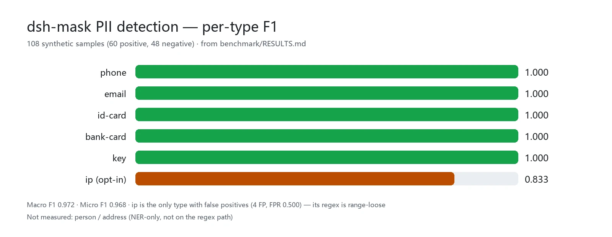

<div align="center">

<picture>
  <source media="(prefers-color-scheme: dark)" srcset="docs/assets/dsh-mask-flow-dark.svg">
  
</picture>

# dsh-mask

**Anonimize dados pessoais antes que cheguem ao modelo — o texto simples nunca entra no seu registro de sessão.**

Um middleware de mascaramento de PII puramente host-side para o DeepSeek Harness: telefones, e-mails, documentos de identidade, cartões bancários e chaves viram marcadores no limite do modelo, e a tabela de restauração fica na sua própria máquina.

[Instalar](#instalação-em-três-passos) · [Configuração](#configuração) · [FAQ](#faq) · [简体中文](README.md) · [English](README.en.md) · [Español](README.es.md) · [Português](README.pt.md) · [हिन्दी](README.hi.md)

[](LICENSE)
[](#compatibilidade)
[](https://www.npmjs.com/package/dsh-mask)
[](https://github.com/PerryLink/dsh-mask/actions/workflows/ci.yml)
[](#compatibilidade)

[](https://github.com/PerryLink/dsh-mask/stargazers)
[](https://www.npmjs.com/package/dsh-mask)
[](https://dshfind.com/plugins/PerryLink/dsh-mask?ref=badge)
[](https://securityscorecards.dev/viewer/?uri=github.com/PerryLink/dsh-mask)
[](https://dsh.market/)
[](https://gitee.com/perrylink/dsh-mask)

```sh
dsh plugin --profile <name> add dsh-mask
```

</div>

<sub>Plugin da comunidade, sem afiliação com a DeepSeek. Repositório canônico: <https://github.com/PerryLink/dsh-mask> (o Gitee é um espelho).</sub>

## O que é

Antes que uma mensagem chegue ao modelo, o `dsh-mask` reescreve os telefones, e-mails, documentos de identidade, cartões bancários e chaves nela contidos em marcadores como `<PHONE_1>` — o que o modelo vê e o que o registro de sessão grava são apenas marcadores. Os originais vivem somente na tabela de restauração host-side (memória mais o domínio de armazenamento controlado `dsh_mask`), e uma chamada explícita de `/mask restore` os devolve como um arquivo com permissão `0600`, cujo caminho — nunca o texto simples — é o que fica registrado. Regex puro, zero dependências, sem requisições de rede.

## Instalação em três passos

1. **Instale** (escolha um canal):

   ```sh
   # git channel (latest main; equivalent to git+https://github.com/PerryLink/dsh-mask.git)
   dsh plugin --profile web add github:PerryLink/dsh-mask
   # npm channel (published releases)
   dsh plugin --profile web add dsh-mask
   # tarball channel: pnpm pack in this repo, then
   dsh plugin --profile web add ./dsh-mask-<version>.tgz
   ```

   Sem etapa de build — `index.mjs` e `lib/` são os artefatos publicados.

2. **Configuração mínima** (padrões sensatos; ajuste a lista de entidades conforme necessário):

   ```yaml
   - insert:
       - id: mask
         name: dsh-mask
         config:
           entities: [phone, email, id-card, bank-card, key]
   ```

3. **Verifique que montou**:

   ```sh
   dsh --profile web --dump-config | grep -A2 'id: mask'
   ```

   ```
   > /mask status
   > /mask restore <PHONE_1>
   mask: restored 1 placeholder(s): <PHONE_1>
     file: /tmp/dsh-mask-restore/restore-1f0c….txt  (mode 0600, one file per session)
   ```

**Desinstalar**: `dsh plugin --profile web remove dsh-mask` (ou remova a linha do patch de perfil).

> O `dsh-mask` não inclui mais a pilha de armazenamento. Perfis que já a compõem (o perfil `web` o faz, via `@deepseek-ai/dsh-web-app`) fornecem `storageDomain`, então a persistência funciona imediatamente. Em um perfil bare sem armazenamento o plugin ainda monta e mascara, mas a tabela de restauração fica só em memória (perdida ao reiniciar) — componha a pilha de armazenamento no seu patch de perfil, ou defina `persistRestoreTable: false`.

<details>
<summary>Instalar a partir do mercado do DSH Desktop</summary>

Todo plugin PerryLink está listado no mercado integrado do DSH Desktop: **Market → Sources → Add source → colar** `https://perrylink-dsh-catalog.perrylink.workers.dev/catalog-source.json` **→ selecionar**. A instalação ainda exige a verificação de identidade npm do mercado e a sua confirmação.

</details>

## Capacidades principais

O `dsh-mask` anonimiza dados pessoais **no limite do modelo** — antes que uma mensagem chegue ao modelo — e mantém uma tabela de restauração host-side para que os marcadores permaneçam reversíveis:

- **Mascaramento no momento da requisição** — mensagens de `agent/pre-step` são reescritas para que telefones, e-mails, documentos de identidade, cartões bancários e chaves (ativados por padrão) e IPs (opt-in) virem marcadores no estilo `<PHONE_1>`. O texto mascarado é o que é registrado e enviado ao modelo.
- **Tabela de restauração** — o mapa `marcador → original` vive apenas em memória e num domínio de armazenamento controlado (`dsh_mask`); o texto simples nunca entra no registro de sessão.
- **Auditoria, não texto simples** — o evento de sessão `mask/applied` registra apenas «N valores substituídos + distribuição por tipo», nunca o texto original ou o mapeamento.
- **Comando `/mask`** — `status` (contagens + distribuição), `on`/`off` (alternância em tempo de execução), `restore <text>` (desmapeia marcadores e entrega o texto simples como arquivo, nunca como texto registrável), `help`.
- **Ferramenta `mask_test`** — passe um trecho pelo detector e veja o resultado com marcadores; nunca revela os valores originais.

```text
user message ──agent/pre-step──▶ placeholders ──model──▶ placeholders ──restore──▶ controlled file
                                   ▲                                                      │
                                   └──────── restore table (memory + dsh_mask) ───────────┘
```

### Superfície de comandos e ferramentas

| Superfície | Revela texto simples | Notas |
|---|---|---|
| Mascaramento `agent/pre-step` | nunca | Reescreve mensagens em marcadores antes de serem registradas ou enviadas ao modelo |
| Mascaramento `tools/post-execute` | nunca | Reescreve blocos de texto de resultados de ferramentas em marcadores antes de serem registrados ou devolvidos ao modelo (escopo: `tools`) |
| `/mask status` | nunca | Estado de ativação, total substituído, distribuição por tipo |
| `/mask on` / `/mask off` | nunca | Alternância em tempo de execução (volta a `config.enabled` ao reiniciar) |
| `/mask restore <text>` | sim (explícito) | Desmapeia marcadores de volta aos valores armazenados para esta sessão e os escreve num arquivo controlado (um por sessão, modo `0600`); o texto do resultado e o registro de sessão carregam apenas esse caminho e os nomes dos marcadores |
| `mask_test` | nunca | Mascara um trecho e reporta o resultado com marcadores + contagens |

### Exemplos

Estes são os pontos de entrada reais do plugin; instale uma vez e chame um.

**Exemplo detalhado** — comando `mask_test`, entrada:

```json
{"text":"电话 13812345678"}
```

Saída:

```text
mask_test: replaced 1 PII value(s) (PHONE=1)
masked:
电话 <PHONE_1>
```

*Observed from `plugins/dsh-mask/index.mjs:243-250; test/index.test.mjs:306-315`*

**Ramo de falha** — entrada:

```text
/mask restore <PHONE_1> with restoreDir=/tmp/dsh-mask-probe-not-a-dir (a regular file)
```

Saída:

```text
mask: restore failed: EEXIST: file already exists, mkdir '/tmp/dsh-mask-probe-not-a-dir'
```

*Observed from `plugins/dsh-mask/index.mjs:501-506; plugins/dsh-mask/lib/deliver.mjs:89-97; plugins/dsh-mask/test/index.test.mjs:278-290`*

**Exemplos breves**: `mask_test` · `/mask restore <text>`

## Dados medidos

<picture>
  <source media="(prefers-color-scheme: dark)" srcset="docs/assets/dsh-mask-evidence-en-dark.webp">
  
</picture>

O benchmark de P/R/F1 por tipo sobre 108 amostras sintéticas (60 positivas, 48 negativas) está publicado em [`benchmark/RESULTS.md`](benchmark/RESULTS.md); regenere-o com `node benchmark/run.mjs` (sem etapa de build, zero dependências novas). O benchmark cobre apenas o caminho de regex: verificações de forma sem checksums, o regex de `ip` é permissivo quanto ao intervalo (daí seus falsos positivos), e `person`/`address` não são medidos.

## Configuração

Todas as opções são campos Schemastery `Config` (alteráveis via cordis.yml). Uma sobrescrita direcionada por id substitui a linha inteira — repita todas as chaves de que precisar. O `cordis.patch.yml` documenta cada chave inline.

Chaves mais usadas:

| Chave | Padrão | Significado |
|---|---|---|
| `enabled` | `true` | Interruptor mestre; `false` desregistra o listener, o comando `/mask` e a ferramenta `mask_test` |
| `mode` | `regex` | Modo de detecção; apenas `regex` está implementado (`regex+ner` para reconhecimento de nomes/endereços é reservado e falha em voz alta) |
| `entities` | `[phone, email, id-card, bank-card, key]` | Quais tipos de PII mascarar; `ip` também é capaz via regex (opt-in), `person`/`address` exigem NER |
| `scope` | `[messages]` | Superfície(s) de mascaramento; `messages` mascara mensagens de agent/pre-step, `tools` mascara texto de resultados de ferramentas em tools/post-execute. Aceita string ou array, ex. `[messages, tools]` |
| `persistRestoreTable` | `true` | Persiste a tabela de restauração no domínio de armazenamento controlado `dsh_mask` (`false` = só memória) |
| `restoreDir` | `''` | Onde o `/mask restore` entrega o texto simples restaurado. Vazio = `os.tmpdir()/dsh-mask-restore`; um valor relativo é resolvido contra o diretório de trabalho do processo host. O diretório é criado `0700` e o arquivo escrito `0600`, um arquivo por sessão |

<details>
<summary>Tabela completa de configuração (11 chaves)</summary>

| Chave | Padrão | Significado |
|---|---|---|
| `enabled` | `true` | Interruptor mestre; `false` desregistra o listener, o comando `/mask` e a ferramenta `mask_test` |
| `mode` | `regex` | Modo de detecção; apenas `regex` está implementado (`regex+ner` para reconhecimento de nomes/endereços é reservado e falha em voz alta) |
| `entities` | `[phone, email, id-card, bank-card, key]` | Quais tipos de PII mascarar; `ip` também é capaz via regex (opt-in), `person`/`address` exigem NER |
| `scope` | `[messages]` | Superfície(s) de mascaramento; `messages` mascara mensagens de agent/pre-step, `tools` mascara texto de resultados de ferramentas em tools/post-execute. Aceita string ou array, ex. `[messages, tools]` |
| `registerCommand` | `true` | Registra o comando `/mask` |
| `registerTools` | `true` | Registra a ferramenta `mask_test` quando o serviço de ferramentas está presente |
| `persistRestoreTable` | `true` | Persiste a tabela de restauração no domínio de armazenamento controlado `dsh_mask` (`false` = só memória) |
| `maxRestoreEntriesPerSession` | `500` | Limite de entradas de restauração por sessão (as mais antigas são removidas primeiro) |
| `maxSessions` | `1000` | Limite de sessões em memória (as menos recentemente usadas são removidas, com o mapeamento recarregado sob demanda) |
| `maskClientEnabled` | `false` | Feature flag para a bolha de «revelação» da metade de navegador (defensiva; desligada por padrão até o catálogo de slots ativos verificar o slot alvo). A chave é declarada no schema e validada, mas nenhum código em execução a lê ainda, então não muda nada até a metade de navegador ser lançada |
| `restoreDir` | `''` | Onde o `/mask restore` entrega o texto simples restaurado. Vazio = `os.tmpdir()/dsh-mask-restore`; um valor relativo é resolvido contra o diretório de trabalho do processo host. O diretório é criado `0700` e o arquivo escrito `0600`, um arquivo por sessão |

</details>

Exemplo de sobrescrita no seu patch de perfil:

```yaml
- insert:
    - id: mask
      name: dsh-mask
      config:
        entities: [phone, email, id-card, bank-card, key, ip]
        persistRestoreTable: false
        registerCommand: true
```

## FAQ

<details>
<summary>Onde o texto simples realmente vive? Ele pode vazar para os logs?</summary>

A tabela de restauração `marcador → original` vive em memória e, quando `persistRestoreTable: true`, no domínio de armazenamento controlado `dsh_mask` — ela **nunca é escrita no registro de sessão**. A única outra cópia em texto simples é o arquivo de entrega que um `/mask restore` explícito escreve sob `restoreDir` (modo `0600`, um arquivo por sessão, sobrescrito pela próxima restauração); nada escreve texto simples em disco de forma implícita.

</details>

<details>
<summary>O que acontece em hosts sem armazenamento ou sem o tipo de evento? Quebra silenciosa?</summary>

Nada é silencioso. Em um perfil bare sem a pilha de armazenamento o plugin ainda monta e mascara, com a tabela de restauração degradando para só memória mais um aviso único. Quando o host não registra o tipo de evento `mask/applied`, os appends de auditoria são omitidos e a primeira recusa por sessão registra um aviso visível. `mode` não implementado (`regex+ner`), entidades NER, valores de `scope` desconhecidos e números fora de faixa falham em voz alta ao carregar.

</details>

<details>
<summary>Ele briga com outros plugins por nomes de comando, eventos ou slots?</summary>

Não. Toda ferramenta tem namespace, ele não fornece nenhuma chave de serviço, não registra nenhum slot de cliente nem prefixo `webServer`, e não muta globais; todo listener de evento compartilhado delega via `next()` e nunca curto-circuita a cadeia. O argumento ponto a ponto está em «Interoperabilidade com outros plugins DSH».

</details>

<details>
<summary>Qual é o tamanho do custo de desempenho?</summary>

O detector é regex puro sem dependências — sem requisições de rede, sem chamadas de modelo — reescrevendo o texto da mensagem de forma síncrona em `agent/pre-step`. Para a precisão medida, veja «Dados medidos» (108 amostras, Macro F1 0.972).

</details>

## Limites de segurança

- **Texto simples nunca entra no registro de sessão.** A forma mascarada (marcadores) é o que é registrado e enviado ao modelo, então o conteúdo visível ao modelo é reconstruível a partir do log na forma de marcadores; os originais ficam na tabela de restauração. A mesma regra governa a direção de revelação: o texto do resultado de um comando é registrado **literalmente** pelo host e renderizado a partir desse mesmo evento, então o `/mask restore` escreve o texto simples num arquivo controlado e devolve apenas o caminho.
- **Sanitizar antes de exibir/registrar.** O `lib/sanitize.mjs` redige PII, segredos e credenciais de URL antes que qualquer texto chegue ao modelo ou ao log; `mask_test`, `/mask status` e todo caminho de erro do `/mask` nunca ecoam originais.
- **Restauração controlada.** `/mask restore` é a única superfície de revelação explícita, e só lê o mapeamento da sessão ativa. Falha é falha fechada: se o arquivo de entrega não puder ser escrito, o comando reporta um erro e nunca recorre a ecoar o texto simples.
- **Falha fechada.** `mode` não implementado (`regex+ner`), valores de `scope` desconhecidos, entidades exclusivas de NER e números fora de faixa falham em voz alta ao carregar.
- **Registros são efeitos.** O listener, o comando, a ferramenta e o fechamento do domínio de armazenamento são todos efeitos Cordis — parar/hot-reload os remove.

## Permissões e dados

- **Permissões**: o `dsh-mask` não faz requisições de rede e não armazena credenciais; lê a sessão no limite `agent/pre-step`, escreve seu próprio domínio de armazenamento `dsh_mask` e escreve o arquivo de entrega do `/mask restore` (o manifest declara `filesystem:write` exatamente para isso). O manifest `dshWorkshop` também declara `network:none` e `credentials:none`.
- **Dados**: veja a primeira entrada do FAQ sobre onde vivem a tabela de restauração e o arquivo de entrega — a conclusão se mantém: texto simples nunca chega ao registro de sessão.
- **Registro de sessão**: `mask/applied` é declarado em `types.d.ts` e anexado apenas quando o host registra o tipo (veja Limitações conhecidas). Seu payload é apenas contagens + distribuição por tipo.

## Limitações conhecidas

- **Somente regex.** O reconhecimento de nomes (`person`) e endereços (`address`) precisa de um reconhecedor NER externo, que a forma host-puro sem dependências não inclui; `mode: regex+ner` e essas entidades falham em voz alta ao carregar. Os tipos de PII cobertos de série são telefone, e-mail, documento de identidade, cartão bancário, chave e (opt-in) IP.
- **Padrões específicos de região.** Os detectores `phone` e `id-card` reconhecem apenas formatos da China continental: `phone` é `1[3-9]` seguido de nove dígitos, e `id-card` é um documento de residente chinês de 18 caracteres (17 dígitos mais um dígito ou `X`). Telefones e identificadores nacionais de outros países não são detectados. `email`, `ip` e `key` não dependem de região; `bank-card` aceita qualquer sequência de 16-19 dígitos com uma pontuação de confiança menor.
- **A restauração na camada de exibição precisa de uma metade de cliente.** O mascaramento é totalmente host-side, mas desmascarar de forma transparente as bolhas do assistente na UI do cliente é uma função da metade de navegador que esta forma host-puro não entrega. O lado host mantém a tabela de restauração e o seam `RestoreStore` exportado (seus métodos recebem um id de sessão), então uma futura metade de cliente os alcançaria por um remoto do host, não diretamente; hoje a superfície de desmascaramento é o comando `/mask restore <text>`, que entrega o texto simples como arquivo porque o resultado de um comando é registrado literalmente (veja Limites de segurança), e a chave `maskClientEnabled` é validada mas ainda não é lida por nenhum código em execução.
- **Não há `/mask restore` sem argumentos.** Restaurar *todos* os marcadores da mensagem mais recente do assistente não é oferecido, e o comando diz isso quando invocado sem texto. Dois fatos do host o impedem: a tabela de restauração é um mapa plano `{marcador: original}` por sessão, sem índice por mensagem, então essa mensagem precisaria ser localizada no registro de eventos da sessão; e o host marcou `Session.snapshotEvents()` / `eventAt()` / `ownEvents()` como obsoletos com um «proibido para novos chamadores» explícito, deixando uma projeção incremental como a única rota sancionada — na qual o corredor de hosts declarado deste plugin (`>=0.1.2-rc.1`) não pode se apoiar. Em vez disso, os marcadores continuam funcionando um a um: `/mask restore <PHONE_1>`.
- **Eventos de sessão em `0.1.7-rc.2`.** O harness registra 59 tipos de evento de sessão e nenhum deles é `mask/*`; seu `Session.append` também não consegue estampar o envelope `ignorable`, então os appends de auditoria do registro de sessão são omitidos e as sessões continuam carregando. A porta não fica em silêncio sobre isso: a primeira recusa por sessão registra um aviso visível nomeando o tipo omitido e esta limitação documentada. O plugin habilita o append automaticamente assim que um host registra o tipo ou suporta o envelope `ignorable`.

## Interoperabilidade com outros plugins DSH

Verificado contra **DSH `0.2.0-rc.2`** (o runtime para o qual este README é publicado) e o conjunto de plugins com mais estrelas pesquisado em 2026-10-05.

Este plugin **não interfere** em outros plugins, incluindo os amplamente instalados com mais estrelas:

- **Sem colisão de nome de ferramenta.** Toda ferramenta tem namespace; nenhum nome puro pertencente a uma ferramenta embutida ou a outro plugin é registrado.
- **Sem colisão de chave de serviço.** Ele não fornece nenhuma chave de serviço, portanto não pode colidir em uma.
- **Sem colisão de slot.** Ele não registra nenhuma chave de slot de cliente, então não pode disputar um assento `shadows-shipped-ui`.
- **Sem colisão de rota HTTP.** Ele não registra nenhum prefixo `webServer`.
- **Sem colisão na camada de patch.** O patch do bundle apenas faz `insert` da própria linha; nunca sobrescreve o `config` de uma linha embutida.
- **Sem mutação global.** Ele não altera protótipos, não reescreve `process.env` nem substitui o dispatcher global de fetch.

**Listeners de eventos compartilhados não interferem por construção.** Ele observa os eventos sensíveis à ordem `agent/pre-step`, `tools/post-execute` com `ctx.on()` — o registro de difusão do Cordis, onde todo listener executa e nenhum pode privar outro do turno. **Todo listener aqui delega via `next()`**, então a cadeia nunca é curto-circuitada, e uma mutação é aplicada ao valor que `next()` produziu em vez de ser devolvida em seu lugar:

- `agent/pre-step` — also used by `dsh-routing-suite` (7000★, 7 listeners), `modlens` (4122★), `dsh-purge` (3317★), `dsh-agent-teams` (1923★), `dsh-context` (1849★).
- `tools/post-execute` — also used by `cc-safety-net` (1576★).

Evidência estática: o `dsh-plugin-doctor` K10–K13 reporta `pass` em todas as verificações deste repositório.

## Compatibilidade

| Superfície | Estado |
|---|---|
| Harness | DeepSeek Harness `dsh-v0.2.1-alpha.1` (adaptado em 2026-09-18): o envelope de sessão mantém seu campo ignorable apenas para compatibilidade de leitura de logs armazenados - o Session.append ainda não consegue estampá-lo, então o comportamento da porta de auditoria não muda. Verificado em 2026-09-18 contra o checkout master dsh-v0.1.7-alpha.1 (cadeia completa de portas + smoke de instalação de perfil). |
| Node | `^22.19.0 \|\| >=24.0.0` |
| Plataformas | Onde o DSH rodar (host puro, regex sem dependências; sem metade de navegador) |
| Modelo | Modelos de texto totalmente suportados; nenhuma capacidade extra de modelo é exigida |

## Ecossistema e qualidade

- [Espelho Gitee](https://gitee.com/perrylink/dsh-mask) (espelho de sincronização; o GitHub é o canônico)
- [Página do plugin no dshfind](https://dshfind.com/plugins/PerryLink/dsh-mask) (instalações e ranking)
- [Relatório OpenSSF Scorecard](https://securityscorecards.dev/viewer/?uri=github.com/PerryLink/dsh-mask) (alimentado por [.github/workflows/scorecard.yml](.github/workflows/scorecard.yml))
- [Relatório de verificação dsh-plugin-doctor](https://github.com/PerryLink/dsh-plugin-doctor#verified-徽章) (K10–K13 todos `pass`)
- [DSH Market](https://dsh.market/) (listado)
- **Canal 1024 store**: `npm i -g dsh1024` uma vez, depois `dsh1024 plugin --profile web add dsh-mask` (conta para o ranking de instalações do [deepseek1024.com](https://deepseek1024.com))
- [Base de conhecimento do ecossistema](https://perrylink.github.io/dsh-plugin-guide/) — dados medidos, não marketing: guia de desenvolvimento de plugins · dados de seleção de plugins · critérios de manutenção

## Desenvolvimento

```sh
pnpm install                                       # node ^22.19 || >=24
pnpm run typecheck && pnpm run typecheck:ci        # two rulers: checkout face (guarded; unverifiable without the checkout) + published-line face
pnpm test                                          # node --test
pnpm run verify:self-contained                     # dependency specs resolve from the registry
pnpm run verify:artifacts                          # shipped files present + index.mjs importable
pnpm run check:readmes                             # five-language README consistency
pnpm pack                                          # the published tarball
```

Não há etapa de build: ESM puro, `index.mjs` e `lib/` são os artefatos publicados. Benchmark: `node benchmark/run.mjs`, resultados em [`benchmark/RESULTS.md`](benchmark/RESULTS.md). As imagens do README são geradas programaticamente por [`scripts/gen-readme-assets.py`](scripts/gen-readme-assets.py) (Python + Pillow) e podem ser regeneradas com segurança.

Topics: `dsh`, `dsh-plugin`, `deepseek-harness`, `deepseek`, `cordis`, `pii`, `mask`, `privacy`, `anonymization`, `security`

## Família e agradecimentos

Este projeto faz parte da família de plugins do DeepSeek Harness da [PerryLink](https://github.com/PerryLink) (todos Apache-2.0). Se for útil, **uma estrela ajuda a próxima pessoa a encontrá-lo** — nada fica bloqueado atrás dela.

- [@PerryLink](https://github.com/PerryLink) — criador e mantenedor: o detector regex de PII portado do Pii-Stripper-Middleware, o seam de mascaramento em `agent/pre-step`, a tabela de restauração, o comando `/mask` e a ferramenta `mask_test`, e a documentação em cinco idiomas.

<details>
<summary>Expandir todos os plugins</summary>

| Plugin | Status |
|---|---|
| **[dsh-aqua-input-check](https://github.com/PerryLink/dsh-aqua-input-check)** |  |
| **[dsh-archive-check](https://github.com/PerryLink/dsh-archive-check)** |  |
| **[dsh-auto-review](https://github.com/PerryLink/dsh-auto-review)** |  |
| **[dsh-autotier](https://github.com/PerryLink/dsh-autotier)** | 🧊 CONGELADO — ver o README do repo |
| **[dsh-bid-ca-precheck](https://github.com/PerryLink/dsh-bid-ca-precheck)** |  |
| **[dsh-bid-qual-check](https://github.com/PerryLink/dsh-bid-qual-check)** |  |
| **[dsh-cert-mcp](https://github.com/PerryLink/dsh-cert-mcp)** | 🧊 CONGELADO — ver o README do repo |
| **[dsh-checkpoint-rewind](https://github.com/PerryLink/dsh-checkpoint-rewind)** |  |
| **[dsh-click](https://github.com/PerryLink/dsh-click)** |  |
| **[dsh-composer-history](https://github.com/PerryLink/dsh-composer-history)** |  |
| **[dsh-contract-stance](https://github.com/PerryLink/dsh-contract-stance)** |  |
| **[dsh-customs-doc-check](https://github.com/PerryLink/dsh-customs-doc-check)** |  |
| **[dsh-data-quality](https://github.com/PerryLink/dsh-data-quality)** |  |
| **[dsh-demurrage-ledger](https://github.com/PerryLink/dsh-demurrage-ledger)** |  |
| **[dsh-doublecheck](https://github.com/PerryLink/dsh-doublecheck)** |  |
| **[dsh-drill-script-check](https://github.com/PerryLink/dsh-drill-script-check)** |  |
| **[dsh-eia-guide-check](https://github.com/PerryLink/dsh-eia-guide-check)** |  |
| **[dsh-emergency-plan](https://github.com/PerryLink/dsh-emergency-plan)** |  |
| **[dsh-essay-rubric-check](https://github.com/PerryLink/dsh-essay-rubric-check)** |  |
| **[dsh-evidence-check](https://github.com/PerryLink/dsh-evidence-check)** |  |
| **[dsh-export-ctl-check](https://github.com/PerryLink/dsh-export-ctl-check)** |  |
| **[dsh-fast](https://github.com/PerryLink/dsh-fast)** |  |
| **[dsh-fmea-table-check](https://github.com/PerryLink/dsh-fmea-table-check)** |  |
| **[dsh-forecast-penalty](https://github.com/PerryLink/dsh-forecast-penalty)** |  |
| **[dsh-fund-research](https://github.com/PerryLink/dsh-fund-research)** |  |
| **[dsh-github](https://github.com/PerryLink/dsh-github)** |  |
| **[dsh-gongwen-flow-check](https://github.com/PerryLink/dsh-gongwen-flow-check)** |  |
| **[dsh-gongwen-word-check](https://github.com/PerryLink/dsh-gongwen-word-check)** |  |
| **[dsh-guard-plan-qc](https://github.com/PerryLink/dsh-guard-plan-qc)** |  |
| **[dsh-hazchem-check](https://github.com/PerryLink/dsh-hazchem-check)** |  |
| **[dsh-hazplan-check](https://github.com/PerryLink/dsh-hazplan-check)** |  |
| **[dsh-hidden-risk-map](https://github.com/PerryLink/dsh-hidden-risk-map)** |  |
| **[dsh-hs-classify](https://github.com/PerryLink/dsh-hs-classify)** |  |
| **[dsh-icd-rule-check](https://github.com/PerryLink/dsh-icd-rule-check)** |  |
| **[dsh-industry-research](https://github.com/PerryLink/dsh-industry-research)** |  |
| **[dsh-lawcite-adapter](https://github.com/PerryLink/dsh-lawcite-adapter)** |  |
| **[dsh-laya](https://github.com/PerryLink/dsh-laya)** |  |
| **[dsh-lc-doc-check](https://github.com/PerryLink/dsh-lc-doc-check)** |  |
| **[dsh-learning-gap-check](https://github.com/PerryLink/dsh-learning-gap-check)** |  |
| **[dsh-library](https://github.com/PerryLink/dsh-library)** |  |
| **[dsh-local-ai](https://github.com/PerryLink/dsh-local-ai)** |  |
| **[dsh-lsp-actions](https://github.com/PerryLink/dsh-lsp-actions)** |  |
| **[dsh-mask](https://github.com/PerryLink/dsh-mask)** |  |
| **[dsh-mcp-panel](https://github.com/PerryLink/dsh-mcp-panel)** |  |
| **[dsh-medrec-qc](https://github.com/PerryLink/dsh-medrec-qc)** |  |
| **[dsh-memento](https://github.com/PerryLink/dsh-memento)** |  |
| **[dsh-nsfc-form-check](https://github.com/PerryLink/dsh-nsfc-form-check)** |  |
| **[dsh-nurse-record-check](https://github.com/PerryLink/dsh-nurse-record-check)** |  |
| **[dsh-observe](https://github.com/PerryLink/dsh-observe)** |  |
| **[dsh-origin-rvc-check](https://github.com/PerryLink/dsh-origin-rvc-check)** |  |
| **[dsh-ota-review-check](https://github.com/PerryLink/dsh-ota-review-check)** |  |
| **[dsh-output-styles](https://github.com/PerryLink/dsh-output-styles)** |  |
| **[dsh-paper-doc-adapter](https://github.com/PerryLink/dsh-paper-doc-adapter)** |  |
| **[dsh-permission-rules](https://github.com/PerryLink/dsh-permission-rules)** |  |
| **[dsh-permit-report-check](https://github.com/PerryLink/dsh-permit-report-check)** |  |
| **[dsh-pipeline-check](https://github.com/PerryLink/dsh-pipeline-check)** |  |
| **[dsh-pleading-draft](https://github.com/PerryLink/dsh-pleading-draft)** |  |
| **[dsh-plugin-doctor](https://github.com/PerryLink/dsh-plugin-doctor)** | 🚫 APOSENTADO (repo arquivado) |
| **[dsh-plugin-guide](https://github.com/PerryLink/dsh-plugin-guide)** |  |
| **[dsh-plugin-kit](https://github.com/PerryLink/dsh-plugin-kit)** | 🚫 APOSENTADO (repo arquivado) |
| **[dsh-plugin-upgrade](https://github.com/PerryLink/dsh-plugin-upgrade)** | 🚫 APOSENTADO (repo arquivado) |
| **[dsh-policy-brief-draft](https://github.com/PerryLink/dsh-policy-brief-draft)** |  |
| **[dsh-power-loss-split](https://github.com/PerryLink/dsh-power-loss-split)** |  |
| **[dsh-power-ticket-check](https://github.com/PerryLink/dsh-power-ticket-check)** |  |
| **[dsh-ppap-check](https://github.com/PerryLink/dsh-ppap-check)** |  |
| **[dsh-protest-deadline](https://github.com/PerryLink/dsh-protest-deadline)** |  |
| **[dsh-railway-window](https://github.com/PerryLink/dsh-railway-window)** |  |
| **[dsh-repair-order-qc](https://github.com/PerryLink/dsh-repair-order-qc)** |  |
| **[dsh-research-report](https://github.com/PerryLink/dsh-research-report)** |  |
| **[dsh-review-reply-check](https://github.com/PerryLink/dsh-review-reply-check)** |  |
| **[dsh-rulefile-check](https://github.com/PerryLink/dsh-rulefile-check)** |  |
| **[dsh-safety-brief-check](https://github.com/PerryLink/dsh-safety-brief-check)** |  |
| **[dsh-score](https://github.com/PerryLink/dsh-score)** |  |
| **[dsh-session-sync](https://github.com/PerryLink/dsh-session-sync)** |  |
| **[dsh-site-log-check](https://github.com/PerryLink/dsh-site-log-check)** |  |
| **[dsh-skill-pack-security](https://github.com/PerryLink/dsh-skill-pack-security)** |  |
| **[dsh-soe-decision-check](https://github.com/PerryLink/dsh-soe-decision-check)** |  |
| **[dsh-soilwater-check](https://github.com/PerryLink/dsh-soilwater-check)** |  |
| **[dsh-sop-sync-check](https://github.com/PerryLink/dsh-sop-sync-check)** |  |
| **[dsh-spc-gbt-adapter](https://github.com/PerryLink/dsh-spc-gbt-adapter)** |  |
| **[dsh-talk](https://github.com/PerryLink/dsh-talk)** |  |
| **[dsh-tender-extract](https://github.com/PerryLink/dsh-tender-extract)** |  |
| **[dsh-tender-matrix](https://github.com/PerryLink/dsh-tender-matrix)** |  |
| **[dsh-test-drive](https://github.com/PerryLink/dsh-test-drive)** |  |
| **[dsh-ticktick](https://github.com/PerryLink/dsh-ticktick)** | 🚫 APOSENTADO (repo arquivado) |
| **[dsh-translate](https://github.com/PerryLink/dsh-translate)** |  |
| **[dsh-warranty-calc](https://github.com/PerryLink/dsh-warranty-calc)** |  |
| **[dsh-budget](https://github.com/PerryLink/dsh-budget)** | 🧊 CONGELADO — ver o README do repo |
| **[dsh-claude-move](https://github.com/PerryLink/dsh-claude-move)** | 🧊 CONGELADO — ver o README do repo |
| **[dsh-defend](https://github.com/PerryLink/dsh-defend)** | 🧊 CONGELADO — ver o README do repo |
| **[dsh-draw](https://github.com/PerryLink/dsh-draw)** | 🧊 CONGELADO — ver o README do repo |
| **[dsh-reach](https://github.com/PerryLink/dsh-reach)** | 🧊 CONGELADO — ver o README do repo |
| **[dsh-background-agents](https://github.com/PerryLink/dsh-background-agents)** | 🚫 APOSENTADO (repo arquivado) |
| **[dsh-session-pin](https://github.com/PerryLink/dsh-session-pin)** | 🚫 APOSENTADO (repo arquivado) |
| **[dsh-team-rooms](https://github.com/PerryLink/dsh-team-rooms)** | 🚫 APOSENTADO (repo arquivado) |

</details>

## Licença

[LICENSE](LICENSE) (Apache License 2.0) © 2026 dsh-mask contributors

<p align="center"><sub>Apache-2.0 · Plugin da comunidade, sem afiliação com a DeepSeek.</sub></p>
